# meYou — UI Plan (Zeydi-style) · `docs/UI_PHASES.md`

> Living instruction file. Every chat does ONE phase, ticks it, logs it, and returns ONE file: the updated `meyou-src.zip`. **This file lives only inside that zip (`docs/UI_PHASES.md`) — it is never delivered or attached separately.**
> It sits next to the reference screenshots in `docs/zeydi-ui/` (19 images, 600 px wide). Phases here are named **U1…U27** (the old Phases 1–11 in `docs/PHASES.md` are done and stay as they are).

---

## 0. راهنمای کاربر (فارسی)

1. در هر چت جدید فقط **آخرین `meyou-src.zip`** را پیوست کن (فایل `docs/UI_PHASES.md` و عکس‌ها **داخل همین zip** هستند؛ هیچ‌وقت جدا پیوست نکن) و «پرامپت شروع» (بخش ۱) را بچسبان.
2. هر چت فقط **یک فاز** (یا دو فاز خیلی کوچک پشت‌سرهم) انجام می‌دهد، تیک می‌زند، لاگ می‌نویسد و **فقط `meyou-src.zip`** به‌روز را تحویل می‌دهد (`UI_PHASES.md` به‌روز داخل همان zip است، نه فایل جدا). بعد از هر چت: zip را نگه دار (مثلاً `meyou-src-after-U3.zip`)، تیک فاز و ردیف لاگ را بررسی کن و همان zip را به چت بعدی بده.
   - **قانون توقف (اجباری):** AI باید قبل از رسیدن به سقف مصرف روزانه در یک نقطهٔ سالم متوقف شود و zip را تحویل بدهد (جزئیات: قانون ۱۱ بخش ۲). اگر خودت می‌دانی سقفت نزدیک است، در همان چت بنویس «سقف نزدیک است» تا AI فوراً در نقطهٔ سالم بایستد.
3. اسکرین‌شات‌های زیدی داخل خود پروژه هستند (`docs/zeydi-ui/`) و در zip قرار می‌گیرند؛ لازم نیست جدا پیوست کنی. هر فاز تصویری خودش فهرست عکس‌های لازم را دارد و AI باید ابتدا آن‌ها را با `view` ببیند.
4. اگر چیزی را نمی‌خواهی، قبل از شروع فاز همان‌جا در بخش «سؤال‌های باز» (۳.۲) پاسخ پیش‌فرض را عوض کن.

---

## 1. Start prompt (paste into a new chat, with ONLY `meyou-src.zip` attached — this file is inside it)

```
Project meYou (React Native + Expo, Android-only). The attached meyou-src.zip is the whole project: it already contains docs/UI_PHASES.md and the reference images in docs/zeydi-ui/. Unzip it first (into a new empty folder).
Read, in this order: docs/UI_PHASES.md completely (sections 1–4 especially, then 5–7 for the phase), docs/HANDOFF.md, docs/PROJECT_BRIEF.md (hard rules + Decisions log), then the files named in the phase. For a visual phase, open (`view`) every image listed under "Look at" in docs/zeydi-ui/ BEFORE writing any UI code, and compare your result with them at the end.
Do ONLY the first unticked phase in UI_PHASES.md section 7 (or the phase I name: {Uxx}).
Rules: follow section 2 exactly — especially rule 11 (STOP at a clean point before the daily usage limit, with checkpoint zips) and rule 12 (UI_PHASES.md lives only inside the zip). UI work only — no new features beyond the phase. Persian (fa, RTL) must stay complete: every new string in fa + en, RTL-safe layout. Do not rewrite finished code that the phase does not touch. Prefer ready-made libraries (web-search the official docs first), thin glue only.
At the end: run pnpm typecheck, pnpm test (and `npx expo export --platform android` when the phase touches routes, assets or native config), tick the phase, write its entry in section 8 (files changed, decisions, checks run, anything left), update docs/HANDOFF.md "Status" in 3–5 lines, then deliver ONE file: meyou-src.zip (it must contain the updated docs/UI_PHASES.md and docs/zeydi-ui/, and no node_modules; verify with `unzip -l`), using SendUserFile/present_files, and a 5-line summary. Do NOT deliver UI_PHASES.md as a separate file. Then stop. If you cannot create files/zips in this environment, say so at the start instead of pretending.
```
```

Bug-fix prompt (any time):
```
The attached meyou-src.zip is the whole project (docs/UI_PHASES.md is inside it). Unzip, read docs/HANDOFF.md and docs/UI_PHASES.md section 2. Fix only this bug with the fewest file changes: <what you see / error text>. No refactor, no new features. Add one line to docs/UI_PHASES.md section 8 under "Fixes". Deliver ONE file: meyou-src.zip (UI_PHASES.md inside, not separate).
```

---

## 2. Rules for every phase

1. **One phase per chat.** Do not start the next phase "because there is room".
2. **UI first.** Do not change business logic (library, storage, security, widget, calendar math) except where the phase says so. Keep existing exports/props working or update every caller.
3. **Persian is mandatory.** Every string exists in `src/i18n/locales/fa.json` and `en.json` (`pnpm test:i18n` must pass). Use `rowOf(isRTL)` / `alignOf(isRTL)` and logical `marginStart/End`; never hard-code left/right. Icons that point (arrows, chevrons) flip in RTL. Fonts: Vazirmatn (fa), Inter (en). Dates stay UTC in storage and are shown in the chosen calendar (Jalali default) with the chosen digits.
4. **Dormant features stay dormant** (section 4). Do not build, enable or call server, sync or partner features. Do not delete their code unless a phase says so.
5. **No dead controls.** A control either works, or is hidden, or (only where section 5 says so) is shown as a clear "coming soon / به‌زودی" shell behind a feature flag.
6. **Reuse.** Check what already exists in `components/`, `src/lib/`, `src/library/ui/` before writing new code. Replace the look inside shared components (e.g. `components/server/ui.tsx`) instead of making parallel copies.
7. **Small commits of work:** do not paste whole files into the chat. Describe changes briefly.
8. **Checks:** `pnpm typecheck`, `pnpm test`; plus `npx expo export --platform android` when routes/assets/native config change. If `pnpm` refuses an install because of `minimumReleaseAge`, do not disable it (see HANDOFF "Checks"). Say plainly what could not be run.
9. **Visual reference is in the repo:** `docs/zeydi-ui/*.jpg` (map in 5.3). At the start of a visual phase `view` the images listed in that phase; at the end compare your result with them (you cannot run a device, so compare structure, spacing, colours and states with the written spec in 5). Never edit or delete these images. Images marked NOT-BUILT are context only.
10. **End of phase checklist:** tick the phase in section 7 · write section 8 entry · update HANDOFF Status (3–5 lines) · append to PROJECT_BRIEF Decisions log only if a decision changed a hard rule · export zip (HANDOFF "Export procedure") · deliver **only `meyou-src.zip`** (see rule 12).
11. **STOP at a clean point before the daily usage limit — MANDATORY.** The AI cannot see its quota, so it must never work "until it breaks". Therefore:
    - **Checkpoints.** Work in small sub-steps (e.g. one screen / one file group). After every sub-step that leaves `pnpm typecheck` green: (a) write or refresh a `PARTIAL` entry for the phase in section 8 (done / left / exact next step), (b) rebuild and deliver `meyou-src.zip` (rule 12). A phase with several sub-steps therefore produces several checkpoint zips; the last one is the final zip. Never deliver a checkpoint with a half-edited file: finish it or revert it first.
    - **Stop signals.** Stop at once, at the next clean point, when: the user says the limit/quota is near (e.g. "سقف نزدیک است", "limit"), the AI sees a usage/limit/rate warning or an error about limits, the conversation has become very long, or the remaining work of the phase is clearly bigger than what is left.
    - **When stopping:** do NOT tick the phase; the section 8 entry is `PARTIAL` (what is done, what is left, exact next step, which checks passed); HANDOFF Status says "U<n> PARTIAL"; deliver the zip; say in one line that the next chat continues the same phase. The next chat starts with the first unticked phase, which is this one.
    - A stop at a clean point is always better than a finished-looking phase that cannot compile.
12. **`UI_PHASES.md` lives ONLY inside `meyou-src.zip` (`docs/UI_PHASES.md`) — this is important.** Never deliver it as a separate file, never ask the user to attach it separately, never keep a second copy elsewhere. Before delivering, run `unzip -l meyou-src.zip` and confirm that `docs/UI_PHASES.md` (the updated one: tick + section 8 entry) and `docs/zeydi-ui/` are inside and that there is no `node_modules`. The user passes this one zip to the next chat.

---

## 3. Decisions

### 3.1 Locked (from the user)
- **Google Drive is removed completely** (code, packages, settings, strings, guides, tests, demo source). No Google sign-in anywhere.
- **Personal server is suspended**: not developed now, but the source must be able to get server connection later. So `src/server`, `src/backup`, `StorageProvider` seams and their tests stay in the repo, compiled, but unreachable from the UI (section 4).
- **Anything that needs a server is suspended**: partner pairing, "add partner", ntfy messages, sending mood/status, sending events/profile, partner notifications, sync.
- **No account / registration / login / Google account.** Zeydi's sign-up, login and "Continue with Google" are not built.
- **Goal of this track:** get the **UI, features' presentation and buttons** as close as possible to Zeydi, simplified and merged with meYou.
- **Add from gallery (and camera)** must exist wherever Zeydi has it: profile photo, diary photos/videos (no app-imposed item limit), event photo, Home camera button. (Today only Library and the event media picker can import from the gallery.)
- **Persian is kept** (fa/RTL, Jalali, Persian digits, Vazirmatn).

### 3.2 Open questions (defaults apply unless the user changes them here)
| # | Question | Default used |
|---|---|---|
| Q1 | Zeydi's Home title "What's up? ⌄" has a dropdown — its content is not visible in the screenshots. | Show the title as plain text (greeting), no chevron, until the user says what it should do. |
| Q2 | Sync (rclone) was Drive→server. | Keep `src/sync` dormant behind the `sync` flag; strip only its Drive side. If it cannot compile after that with small edits, delete it and log it. `server/rclone/` docs stay. |
| Q3 | Gender step and "Track cycle" in Zeydi onboarding. | Not built (brief rule: gender-neutral; cycle tracking is a feature, not UI). |
| Q4 | Notification-permission step of onboarding. | Not built now (its text is about partner pushes). Revisit with the server. |
| Q5 | Zeydi's "Publish" (diary) / "Share Status" shares with the partner. | Buttons read **Save / ذخیره** and **Save status / ثبت وضعیت** and store locally. |
| Q6 | Accent colour and theme default. | New default accent **coral `#FF6B6B`**; the six existing accents stay selectable. Theme default stays **Auto** (follows the system, like Zeydi's "System"); the dark palette is Zeydi's navy; the light palette is derived. |
| Q7 | Where do captured camera photos go? | App library folder (`Snaps`), not the phone gallery. |
| Q8 | Mood/activity wording. | Neutral, gender-neutral, no explicit items (do not copy Zeydi's explicit mood names). Brief rule 8 is amended in U3: coral accent and a heart icon are allowed; sexual/romantic-cliché content is not required. |
| Q9 | Month-grid view of Events (Zeydi has none). | Keep as an optional toggle in the Events header; default view = Upcoming/Past list. |
| Q10 | Days-together card and widget (Zeydi has none). | Keep (the widget depends on it), restyled. Its "together since" date is set in Settings > profile, locally. |

---

## 4. Dormant-feature policy (server · sync · partner)

Create `src/constants/features.ts` in **U2**:
```ts
export const FEATURES = { server: false, sync: false, partner: false } as const;
```
- `partner:false` → `PartnerListener` is not mounted; no pairing/ntfy/publish calls; no partner rows in Settings; no bell icon on Home.
- `server:false` → no "Personal server" in sources, no server settings section, no backup-to-server UI, no uploads queue screen link. `src/server`, `src/backup`, `src/storage/*` keep compiling and their tests keep passing.
- `sync:false` → no sync screens/rows. (Since U1 there are no sync screens at all: the Drive→server mapping UI was deleted; only the generic rclone client in `src/sync/` remains. Q2 resolved that way.)
- **Shells** (shown, clearly "coming soon"): only the Home "Connect Partner" card. Everything else dormant is hidden.
- **Local replacements:** status/mood, events and diary save **on the phone only** (SQLite). Fields that exist only for sharing (e.g. event `surprise`) are stored now so the future server phase can use them.
- **Re-enabling later** = flip the flag, then re-test. Do not delete the flagged code paths.
- Never add tokens/URLs/secrets to the UI during this track.

---

## 5. Design reference (extracted from the 20 Zeydi screenshots)

### 5.1 Tokens (sampled from the screenshots; ± a few units)
| Token | Dark (default) | Notes |
|---|---|---|
| `background` | `#040B15` | near-black navy |
| `card` / input fill / tile | `#112240` | |
| `sheet` (bottom sheet) | `#0A1930` | scrim behind |
| `navBar` | `#0D1C33` | floating pill |
| `raised` (icon tile, track) | `#1B3156` / track `#223555` | |
| `primary` (coral) | `#FF6B6B` | buttons, active tab, FAB, links |
| `primaryPressed` / progress | `#FF5353` | |
| `fabGlow` | coral at ~35% opacity, radius ~18 | |
| `inputFocusBorder` | coral at ~40% opacity | |
| `mutedForeground` | ≈ `#8B97A8` | estimate; labels, hints |
| `switchOn` | `#2196F3` | system-like blue switch |
| `moodSelected` | `#9A28B1` + glow | selected emoji tile |
| `statusCardTint` | `#261C35` (purple tint of selected mood) | |
| Welcome gradients | coral `#FEA4A4`, teal `#93F2EC`, yellow `#FFD84F`, violet `#7163EE` → fading into dark navy at the bottom, soft wave shapes | |
| Radii | pill `999`, card `24–32`, tile `18–20`, sheet top `28` | |
| Type | Inter-like (en) / Vazirmatn (fa); title 30–34 bold, section label 12–13 uppercase + letter-spacing (en only), body 15–16 | |
| Light theme | derive from the same hues: background `#F6F8FB`, card `#FFFFFF`, border `#E3E8F0`; keep coral | |

### 5.2 Screen specs
**Welcome (4 slides, first run only):** gradient background per slide with soft waves; top-left round logo + app name + tagline; centre glass card (blur + 1px light border, radius 28) with a mini preview, title, one-line text; pill indicator dots (active = long pill); bottom area = ONE button "Get started / شروع" (no account buttons). Slides for meYou: Status/mood · Events with countdown · Diary · Gallery.
**Onboarding (3 steps):** back arrow + coral progress bar (track `#223555`); big title + muted subtitle; step 1 name (filled input, coral focus border), step 2 birthday (segmented Gregorian/Jalali + 3-column wheel with highlighted centre row), step 3 photo (big circle avatar placeholder + coral camera badge; options Camera / Gallery); "Next step" pill, disabled style = `#223555`-ish fill + muted text.
**Home:** header = round coral avatar (opens Settings) · centre title · (bell: dormant/hidden). Big gradient card "Connect with Zeydi" (dormant shell, "coming soon" badge). Section "THIS WEEK" with count at the end ("0 Events", coral) and empty text. Round camera FAB (coral, glow) bottom-end above the bar.
**Floating tab bar:** pill, margin ~16 from edges and above the system bar, radius 28, 4 tabs; active = pill-shaped tinted background + filled icon + coral label; inactive = muted icon + label.
**Status:** top card = big emoji + "Feeling …" + "Ready to share mood" (tinted with the selected mood colour). Section "MOODS" (search + chips: All · Positive · Energetic · Calm · Neutral …) then grid of rounded-square emoji tiles, ≥6 columns, horizontally scrollable; selected = purple with glow. Section "ACTIVITIES" (search + chips) then wrapping tiles with emoji + name (ellipsized). Floating pill button "Share status" (coral) above the bar.
**Events:** two text tabs Upcoming / Past with coral underline; empty state: text + coral heart link "Set your next date"; round FAB (calendar +). **New Event** = bottom sheet: Cancel · title · Add (muted until valid); card 1: title + "what's gonna happen" lines; card 2: Date row (opens picker), Icon row (expands a grid of 7 round-square icon tiles: heart, cake, party, plane, glass, briefcase, dumbbell; selected = coral border); card 3: "Surprise event — hidden from partner" toggle with 🤫.
**Diary:** search field with coral magnifier · two dropdown pills "Newest ⌄" / "Categories ⌄" · opening a dropdown shows a row/wrap of chips (Newest first/Oldest first; All · Saved · Date night · Travel · Milestone · Random · Gift · Fight/Make up) · empty state with coral open-book link · FAB (book +). **New Entry:** back + centred title; photo box (coral dashed/solid border, "Add photos (0/4)"); big title input "Title your memory…"; Category chips; "How did you feel?" emoji circles row; large body "Dear diary, today was wonderful because…"; fixed bottom pill "Publish" (→ Save).
**Settings:** header = circular back button + title; profile card (avatar, name, "Edit personal details ›"); grouped rounded cards with hairline dividers; each row = tinted icon + label + (value or switch or ›); group labels uppercase muted: GENERAL (Notifications switch*, Widget setup and refresh, Theme segmented System/Light/Dark, Calendar value), ZEYDI group (Znap archive, Invite*, Join*), LEGAL (Privacy policy, Terms of service), ACCOUNT. *dormant/hidden in meYou.

### 5.3 Screenshot map (images are in `docs/zeydi-ui/`)

Screenshot #19 (a Samsung screenshot toolbar over the Diary) was left out on purpose; numbering is kept so older notes still match.

| # | File | Screen | Preview |
|---|---|---|---|
| 01 | `01-welcome-coral.jpg` | Welcome slide 1 (coral) | 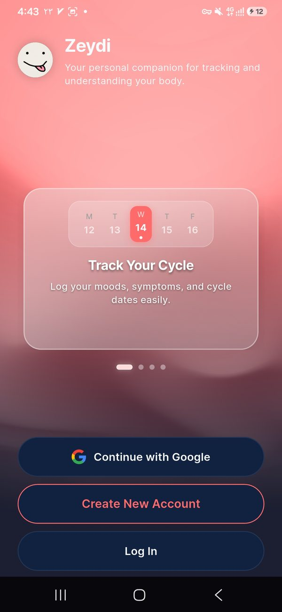 |
| 02 | `02-welcome-teal.jpg` | Welcome slide 2 (teal) | 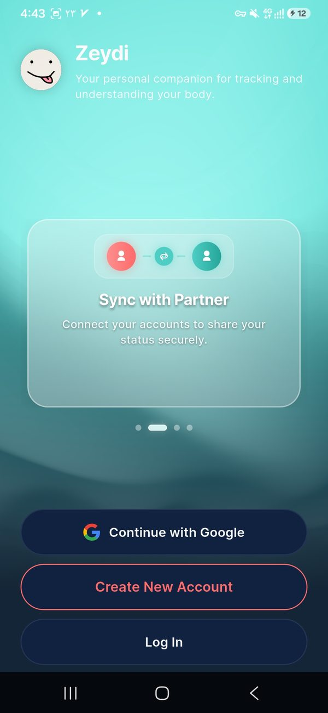 |
| 03 | `03-welcome-yellow.jpg` | Welcome slide 3 (yellow) | 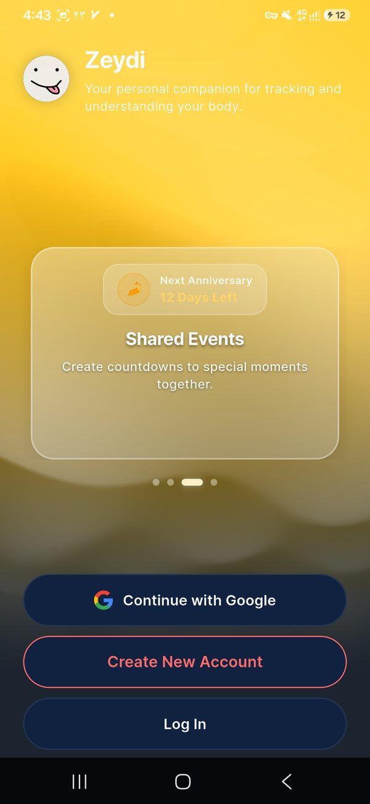 |
| 04 | `04-welcome-violet.jpg` | Welcome slide 4 (violet) | 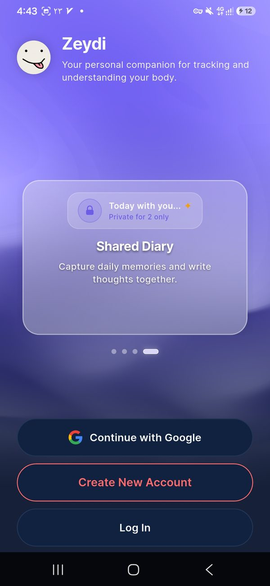 |
| 05 | `05-onboarding-name.jpg` | Onboarding: name | 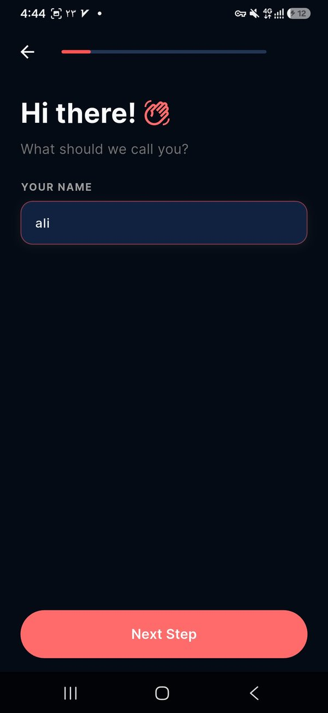 |
| 06 | `06-onboarding-birthday.jpg` | Onboarding: birthday wheel | 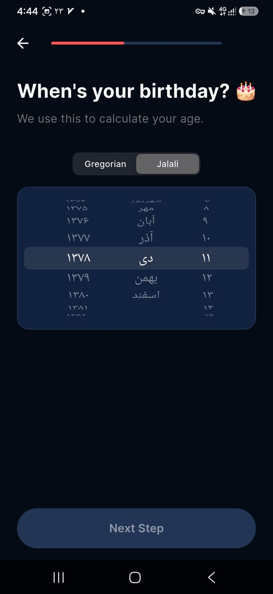 |
| 07 | `07-onboarding-gender-NOT-BUILT.jpg` | Onboarding: about you (gender) — not built | 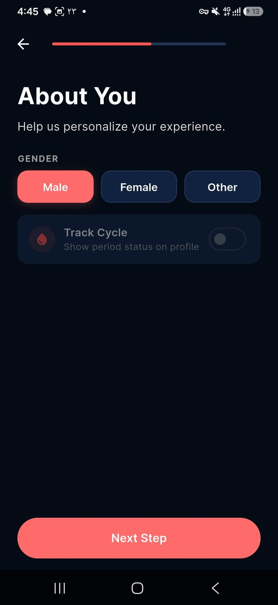 |
| 08 | `08-onboarding-photo.jpg` | Onboarding: photo | 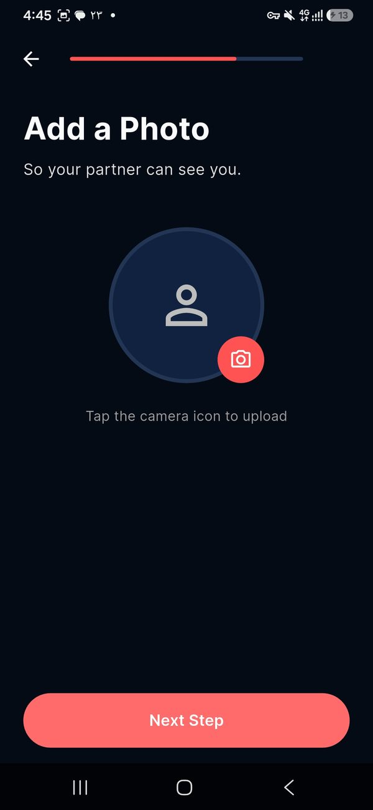 |
| 09 | `09-create-account-NOT-BUILT.jpg` | Create account — not built | 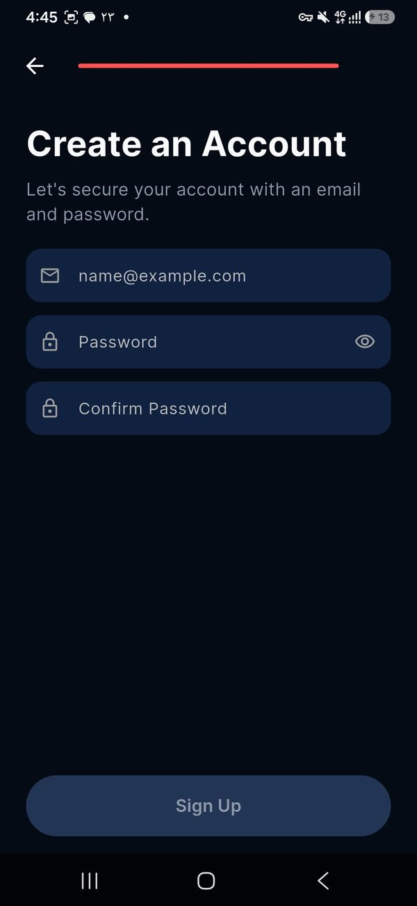 |
| 10 | `10-notification-permission-NOT-BUILT.jpg` | Notification permission — not built | 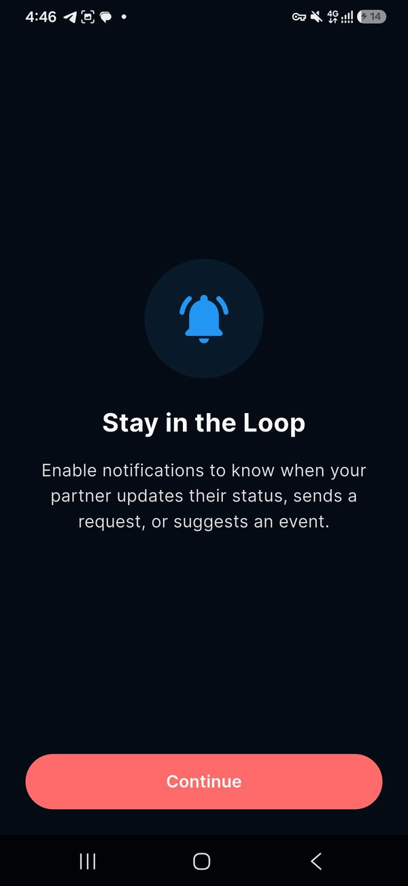 |
| 11 | `11-settings.jpg` | Settings | 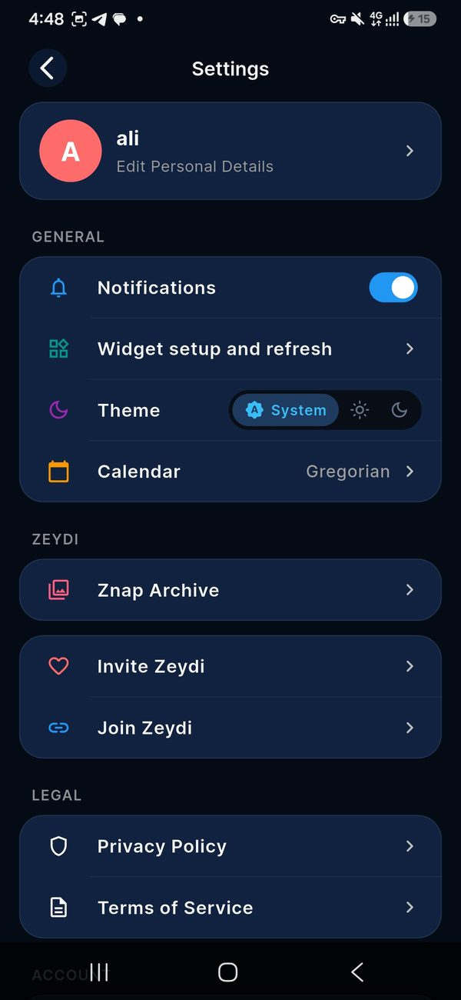 |
| 12 | `12-home.jpg` | Home | 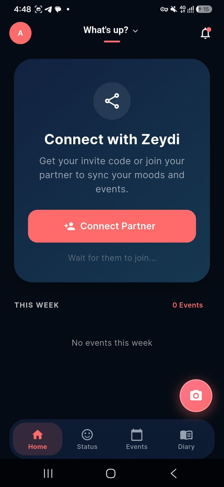 |
| 13 | `13-status.jpg` | Status | 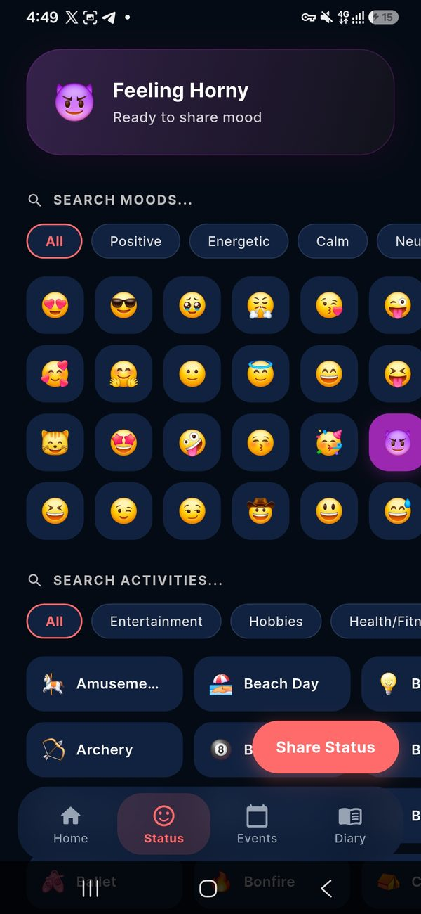 |
| 14 | `14-events.jpg` | Events list | 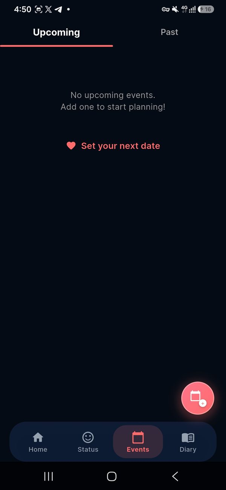 |
| 15 | `15-new-event.jpg` | New event sheet | 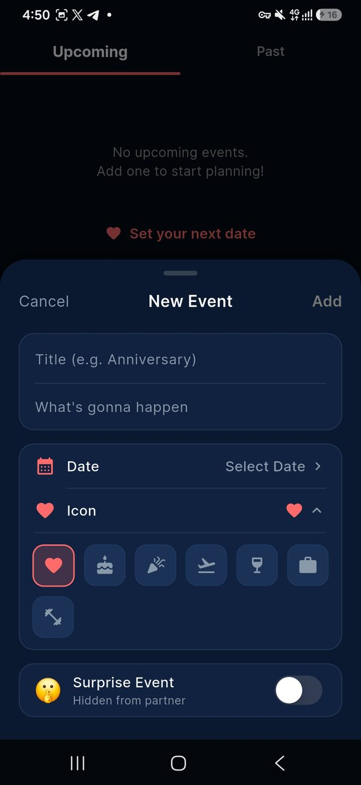 |
| 16 | `16-diary.jpg` | Diary list | 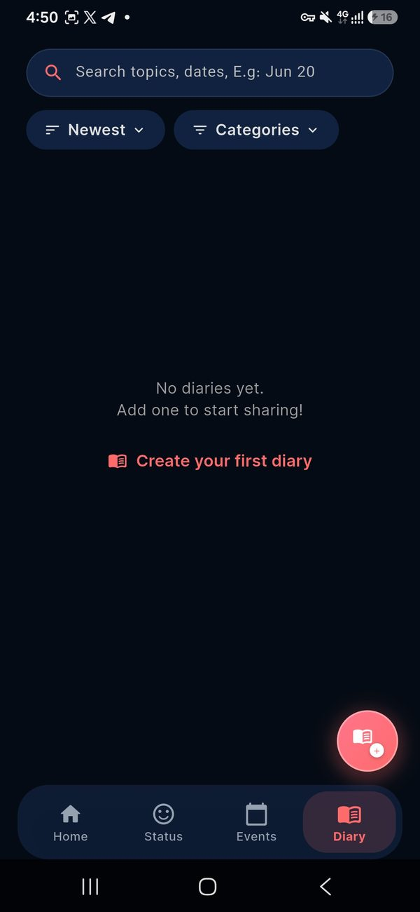 |
| 17 | `17-diary-sort-open.jpg` | Diary: sort open | 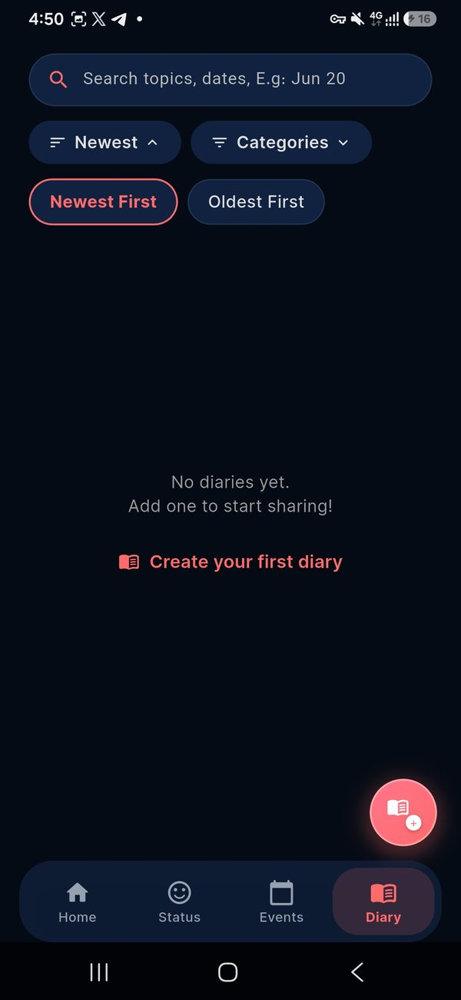 |
| 18 | `18-diary-categories-open.jpg` | Diary: categories open | 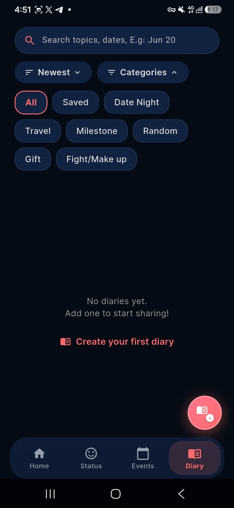 |
| 20 | `20-new-diary-entry.jpg` | New diary entry | 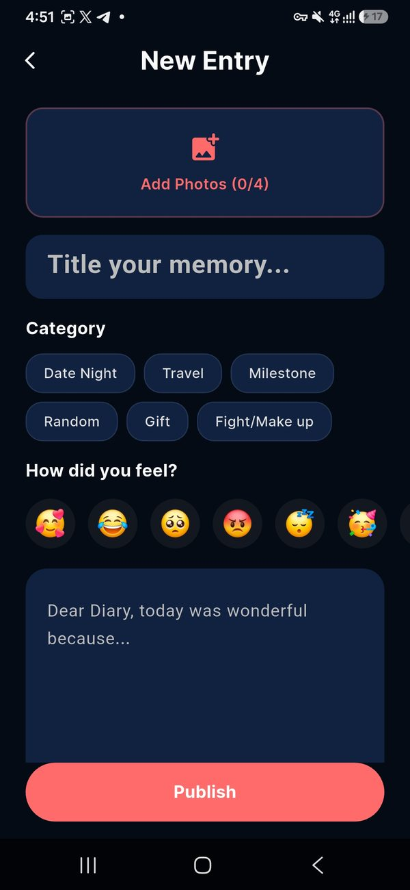 |

---|---|---|
| 01 | `…164323.jpg` | Welcome slide 1 (coral) |
| 02 | `…164327.jpg` | Welcome slide 2 (teal) |
| 03 | `…164331.jpg` | Welcome slide 3 (yellow) |
| 04 | `…164334.jpg` | Welcome slide 4 (violet) |
| 05 | `…164414.jpg` | Onboarding: name |
| 06 | `…164434.jpg` | Onboarding: birthday wheel |
| 07 | `…164508.jpg` | Onboarding: about you (gender) — not built |
| 08 | `…164516.jpg` | Onboarding: photo |
| 09 | `…164549.jpg` | Create account — not built |
| 10 | `…164627.jpg` | Notification permission — not built |
| 11 | `…164802.jpg` | Settings |
| 12 | `…164812.jpg` | Home |
| 13 | `…164918.jpg` | Status |
| 14 | `…165016.jpg` | Events list |
| 15 | `…165023.jpg` | New event sheet |
| 16 | `…165040.jpg` | Diary list |
| 17 | `…165058.jpg` | Diary sort open |
| 18 | `…165108.jpg` | Diary categories open |
| 19 | `…165109.jpg` | (Samsung screenshot toolbar over Diary — ignore) |
| 20 | `…165123.jpg` | New diary entry |

---

## 6. Target structure

**Tabs (4, floating pill bar):** `index` Home · `status` Status · `events` Events · `diary` Diary. Fa labels: **خانه · وضعیت · رویدادها · خاطرات**.
**Stack screens:** Settings (`app/settings/index.tsx`, opened from the Home avatar), Library (`app/library.tsx`, opened from Home/Settings), Viewer, existing settings sub-screens, `welcome` + `onboarding/*` (first run only, gated by `onboarded` in the settings store).
**Route renames (U6):** `(tabs)/mood.tsx → status.tsx`, `(tabs)/dates.tsx → events.tsx`, `(tabs)/settings.tsx → app/settings/index.tsx`, new `(tabs)/diary.tsx`. Update every `router.push('/mood' | '/dates' | …)` and the widget deep link if any.
**New data (local SQLite, migrations continue the numbering in `src/lib/database.ts`):** `moods` + `activity` column (U13) · `events` + `description`, `icon`, `surprise` (U16) · new `diary` table (U19).
**Reference images:** `docs/zeydi-ui/` (19 jpg, committed to the repo, part of every source zip).
**New shared pieces:** `src/constants/features.ts` · `constants/theme.ts` (non-colour tokens) · `components/ui/*` (BottomSheet, Fab, Chip, SegmentedControl, ProgressBar, EmptyState, SectionLabel, IconTile, FloatingTabBar) · `components/media/MediaSourceSheet.tsx` (Camera / Gallery) · `src/media/pick.ts` (gallery+camera → library folder).

---

## 7. Phase checklist

Legend: `[ ]` not started · `[x]` done (with date, in section 8).
Every phase also obeys section 2. "Look at" = reference images in `docs/zeydi-ui/` that the AI must open with `view` before building that phase.

### [x] U1 — Remove Google Drive completely (2026-10-16)
**Scope:** delete `src/drive/`, `src/state/drive-store.ts`, `app/settings/add-drive.tsx`, `app/settings/drive-guide.tsx`, `scripts/test-drive.mjs`, `scripts/fake-drive.mjs`, `scripts/fixtures/drive/`, the `test:drive` script **and its call inside the `test` script in `package.json`**, the `@react-native-google-signin/google-signin` dependency and its plugin entry in `app.json`, the `drive` kind and `mock-drive` source in `sources-store.ts`; remove Drive from `registry.ts`, `sources-store.ts` (`addDriveSource`, demo Drive source), `src/storage/types.ts`/`mock-provider.ts` where Drive-specific, `backup-new.ts`/`run-backup.ts` (Drive fallback target), `free-up.ts`, `storage-stats.ts`, `merge.ts`, `EntryCell.tsx`, `viewer.tsx`, `duplicates.tsx`, `storage-analyzer.tsx`, Sources and Settings rows, all Drive i18n keys (fa+en), README/docs mentions. Sync's Drive side: apply Q2.
**Not built:** anything new. **Done when:** no `drive` import or string remains (grep clean except history in docs), typecheck + all tests green, `expo export` green.

### [x] U2 — Feature flags + dormant server/sync/partner (2026-10-16)
**Scope:** add `src/constants/features.ts` (section 4); do not mount `PartnerListener`; filter Settings sections/rows, Sources ("Personal server"), backup/uploads/sync entries, partner rows, partner notification rows by flags; Home keeps only the "Connect Partner" shell (restyled later, U11); `sendMood`/`sendEvent`/`sendProfile` callers are guarded by `FEATURES.partner`; add `saveMoodLocal` (writes a `from_me` row with a local msg id) and make the mood screen use it while the flag is off; events save locally without publish.
Also in `app.json` remove the `react-native-notify-kit` plugin entry (it declares a foreground service for the partner relay, which is not needed while the partner is dormant); keep the package and `src/partner/background-service.ts` (it imports the kit lazily) and note the entry in the re-enable guide. Keep `expo-notifications`, `expo-build-properties` (cleartext, for the future server) and the `expo-camera` plugin. Hide the whole Sources screen (the Local source stays always on; mock sources stay disabled).
**Done when:** app runs with nothing server-related reachable; all existing tests (partner/server/sync) still pass because the code is intact; flipping a flag to `true` brings the old UI back.

### [x] U3 — Design tokens + theme (2026-10-16)
**Scope:** new palette in `constants/colors.ts` (dark navy default + derived light, tokens from 5.1: `background, card, sheet, navBar, raised, border, primary…`), add accent `coral` (`#FF6B6B`) as default (`AccentName`), keep the other six; `constants/theme.ts` for radii/spacing/typography; extend `useColors`; settings-store default accent/theme migration (persist version bump, existing users keep their choice); amend PROJECT_BRIEF hard rule 8 + Decisions log (coral/heart allowed, Q8); align `app.json` splash `backgroundColor` (light and `dark`) and the adaptive-icon background with the new palettes.
**Look at (`view` these files first):** `docs/zeydi-ui/11-settings.jpg`, `docs/zeydi-ui/12-home.jpg`, `docs/zeydi-ui/13-status.jpg`. **Done when:** every existing screen renders in the new dark/light palettes without hard-coded old colours left in shared components; typecheck + tests green.

### [x] U4 — UI kit A: buttons, cards, chips, labels, empty state (2026-10-16)
**Scope:** restyle inside `components/server/ui.tsx` (Button: primary coral pill, outline coral pill, dark navy pill; Card radius 24–28; Notice) and add `components/ui/` `Chip`, `SectionLabel`, `EmptyState` (muted text + coral action link), `IconTile`. All screens inherit the new look without API breaks.
**Look at (`view` these files first):** `docs/zeydi-ui/01-welcome-coral.jpg`, `docs/zeydi-ui/13-status.jpg`, `docs/zeydi-ui/16-diary.jpg`. **Done when:** a quick demo screen (dev-only route or Settings > Tools diagnostics preview, removed afterwards) shows all variants in fa and en.

### [x] U5 — UI kit B: inputs, sheet, FAB, segmented, progress, back button (2026-10-16)
**Scope:** `Input` (filled `card` colour, left icon, coral focus border, password eye), `Toggle row`, `SegmentedControl` (Gregorian/Jalali, System/Light/Dark), `BottomSheet` (drag handle, scrim, header Cancel · title · Action, keyboard aware — evaluate `@gorhom/bottom-sheet` vs a small Modal; choose the simplest), `Fab` (round + glow, and extended pill variant), `ProgressBar`, circular `BackButton` header. RTL-safe.
**Look at (`view` these files first):** `docs/zeydi-ui/05-onboarding-name.jpg`, `docs/zeydi-ui/09-create-account-NOT-BUILT.jpg`, `docs/zeydi-ui/15-new-event.jpg`, `docs/zeydi-ui/11-settings.jpg`. **Done when:** each component works in fa/RTL and en/LTR with keyboard open.

### [x] U6 — Navigation shell: 4 tabs + floating bar + route renames (2026-10-16)
**Scope:** `FloatingTabBar` (pill, margin, radius 28, active pill tint, filled icon + coral label), tabs Home/Status/Events/Diary (fa labels in section 6), Settings leaves the tabs and becomes a stack screen from the Home avatar, route renames + every caller updated, `ScreenFrame` bottom padding so content clears the bar, placeholder Diary tab ("coming" empty state is NOT shown: render the real empty state from U4 with a disabled FAB until U20).
**Look at (`view` these files first):** `docs/zeydi-ui/12-home.jpg`, `docs/zeydi-ui/13-status.jpg`, `docs/zeydi-ui/14-events.jpg`, `docs/zeydi-ui/16-diary.jpg`. `experiments.typedRoutes` is on: after renaming routes regenerate the typed-route declarations (run `npx expo export --platform android` or start the dev server once) before judging `pnpm typecheck`; there are only two `router.push('/mood')` callers today (both in `app/(tabs)/index.tsx`) — grep for others anyway.
**Done when:** navigation works in both languages, RTL mirrors the tab order, back stack is sane, `expo export` green.

### [x] U7 — Media pick kit (camera + gallery) (2026-10-16)
**Scope:** `src/media/pick.ts` (`pickFromGallery({multiple, max})`, `captureFromCamera()` via `expo-image-picker`; results copied into the app library folder through the existing local provider; camera shots go to folder `Snaps`, Q7), reuse/extend `importFromPhone`; `components/media/MediaSourceSheet.tsx` (BottomSheet with Camera / Gallery rows, Files only where relevant); permissions: add the `expo-image-picker` plugin to `app.json` (it is NOT there today) with a camera + photos permission text, and update the `expo-camera` permission text (it currently says "only to scan QR codes"); the Snaps folder needs a tiny `createFolder` helper on the local provider if none exists (`upload` accepts an `fs:` parent id) — fallback: save in the library root with a `snap-` name prefix; friendly fa/en error + permission-denied text; thumbnails/keys come back as Library keys.
**Not built:** save to phone gallery. **Done when:** the sheet opens from a temporary button, returns keys for 1..N items, and picked items show in Library; `expo prebuild` config check green.

### [x] U8 — Welcome carousel (first run, no account) (2026-10-16)
**Scope:** gate on first run: `onboarded` in the settings store (persist version **3 → 4** since U3 already took 2 → 3; the migration sets `onboarded: true` for existing installs so they skip welcome), wait for store hydration before redirecting (same pattern as `components/security/AppLockGate.tsx`: `persist.hasHydrated()` / `onFinishHydration`), otherwise the welcome flashes. `app/welcome.tsx`: 4 gradient slides (`expo-linear-gradient`), glass card (`expo-blur`), animated indicator, logo + name + tagline, ONE "Get started / شروع" button; `onboarded` flag in settings store; root layout redirects first-run users to welcome, others to tabs. Slide content = meYou features that exist (Status, Events countdown, Diary, Gallery).
**Look at (`view` these files first):** `docs/zeydi-ui/01-welcome-coral.jpg`, `docs/zeydi-ui/02-welcome-teal.jpg`, `docs/zeydi-ui/03-welcome-yellow.jpg`, `docs/zeydi-ui/04-welcome-violet.jpg`. **Not built:** Google/Create account/Log in buttons. **Done when:** first run shows welcome, second run does not; Persian slides complete.

### [x] U9 — Onboarding steps (name · birthday · photo) (2026-10-16)
**Scope:** `app/onboarding/*` with `ProgressBar` + back arrow; step 1 name; step 2 birthday with Gregorian/Jalali segmented control and a 3-column wheel (use a maintained wheel-picker library after a web search, else a small snap `FlatList`), uses `jalaali-js` + `src/partner/birthday.ts` (UTC ISO storage); step 3 photo via `MediaSourceSheet` (avatar shrink to 64 px as in `src/partner/avatar.ts`, add camera option); saves to my profile in `partner-store` (no publishing); "Next step" disabled style until valid; finishing sets `onboarded`.
**Look at (`view` these files first):** `docs/zeydi-ui/05-onboarding-name.jpg`, `docs/zeydi-ui/06-onboarding-birthday.jpg`, `docs/zeydi-ui/08-onboarding-photo.jpg`. **Done when:** a fresh install completes onboarding in fa and en and the name/avatar show on Home/Settings.

### [x] U10 — (reserved) first-run polish (2026-10-16, skipped — no gaps)
**Scope:** only if U8–U9 left visual gaps (transitions, keyboard, tiny screens 320 dp). If nothing is needed, tick it with "skipped — no gaps" in section 8.

### [x] U11 — Home A: header, Connect shell, This week, FAB (2026-10-16)
**Scope:** header (round avatar → Settings, plain title per Q1, no bell); dormant "Connect with meYou" gradient card with disabled coral button + "coming soon / به‌زودی" badge (flag-driven: hidden entirely when someone later pairs); `THIS WEEK` section with count and EventItem rows (week range from `recurrence.ts`, week start from settings) + empty state; camera FAB → `MediaSourceSheet` → saves to `Snaps` (the snaps then show as the `Snaps` folder in Library; no separate archive screen).
**Look at (`view` these files first):** `docs/zeydi-ui/12-home.jpg`. **Done when:** Home matches the spec in fa and en; FAB adds a snap.

### [x] U12 — Home B: my status, days together, on this day (2026-10-16)
**Scope:** below "This week": "My status" card (latest local status, tapping opens Status tab), "Days together" card restyled (kept for the widget; local "together since" date), "On this day" card restyled; shortcut row to Library ("Library / آرشیو" entry; replaces the old quick-action buttons); remove the old HomeCard styling. Home never starts a library scan.
**Look at (`view` these files first):** `docs/zeydi-ui/12-home.jpg`, `docs/zeydi-ui/11-settings.jpg`. **Done when:** all cards render with and without data; widget value equals the card.

### [x] U13 — Status A: data layer (2026-10-16)
**Scope:** migration: `moods.activity TEXT NULL`; `mood-db.ts` (`saveMoodLocal`, `latestMood`, history incl. activity); `src/partner/moods.ts` extended: categories Positive · Energetic · Calm · Neutral · Hard (≥ 36 emojis, neutral names, fa+en labels) and `src/partner/activities.ts` (≈ 40 neutral activities with emoji, categories Entertainment · Hobbies · Health/Fitness · Social · Home · Travel; fa+en names); pure helpers + tests in `scripts/test-partner.mjs` (or a new `test-status.mjs` wired into `pnpm test`). Intensity and note UI are dropped (stored default 3, note null).
**Done when:** unit tests cover save/latest/history/search helpers; old rows still load.

### [x] U14 — Status B: mood UI (2026-10-16)
**Scope:** `app/(tabs)/status.tsx`: top status card (big emoji, "Feeling …", subtitle, tint from selected mood), moods section (search field + category chips + horizontally scrollable emoji tile grid, selected = purple glow), haptic on select. No activities yet.
**Look at (`view` these files first):** `docs/zeydi-ui/13-status.jpg`. **Done when:** selecting a mood updates the card; search and chips filter in fa and en.

### [x] U15 — Status C: activities + Save status + history (2026-10-16)
**Scope:** activities section (search, chips, wrapping tiles with ellipsis), floating "Save status / ثبت وضعیت" pill (saves local status, success haptic, toast), small history entry point (sheet with recent statuses, date in chosen calendar), Home "My status" card now live.
**Look at (`view` these files first):** `docs/zeydi-ui/13-status.jpg`. **Done when:** saved status appears on Status top card and Home; no network code touched.

### [x] U16 — Events A: data layer (2026-10-16)
**Scope:** migration: `events.description TEXT`, `icon TEXT`, `surprise INTEGER DEFAULT 0`; `events-db.ts` (`EventRow` + `saveEvent`), `src/events/icons.ts` (7 icons mapped to Feather/Ionicons: heart, cake, party, plane, glass, briefcase, dumbbell); extend `test-events.mjs`; partner `event` message type untouched (dormant), but surprise events must be excluded from any future publish (guard + test).
**Done when:** old events load with defaults; tests green.

### [x] U17 — Events B: list screen (2026-10-16)
**Scope:** `app/(tabs)/events.tsx`: Upcoming / Past text tabs with coral underline, restyled `EventItem` (icon tile, title, date in chosen calendar, countdown chip, surprise marker), empty state ("Set your next date" link), calendar FAB; header icon toggles the optional month grid (Q9) reusing the existing grid code, restyled.
**Look at (`view` these files first):** `docs/zeydi-ui/14-events.jpg`. **Done when:** a Jalali and a Gregorian yearly event show the right countdown (existing behaviour preserved).

### [x] U18 — Events C: New/Edit event sheet — 2026-10-16
**Scope:** replace `app/event.tsx` UI with a `BottomSheet` (Cancel · title · Add): card with title + description; Date row (picker in the chosen calendar; reuse the Phase 8 date input logic), Icon row (expandable 7-icon grid), repeat-yearly row, Surprise toggle with 🤫, optional photo via `MediaSourceSheet` (camera + gallery); edit and delete (confirm) reuse the same sheet; keep tag parsing but hide the tags UI.
**Look at (`view` these files first):** `docs/zeydi-ui/15-new-event.jpg`. **Done when:** create/edit/delete work in fa and en; Add is disabled until title + date.

### [x] U19 — Diary A: data layer (2026-10-16)
**Scope:** migration `diary` (`id, title, category, mood, body, media_keys JSON (≤ 4), saved INTEGER, created_at, updated_at`); `src/diary/diary-db.ts` (CRUD, search by title/body/date text in the chosen calendar, sort newest/oldest, filter by category and Saved), `src/diary/categories.ts` (Date night · Travel · Milestone · Random · Gift · Fight/Make up → fa: قرار · سفر · نقطه‌عطف · متفرقه · هدیه · دعوا و آشتی), `scripts/test-diary.mjs` wired into `pnpm test`.
**Done when:** pure/DB tests cover CRUD, search, sort, filters.

### [x] U20 — Diary B: list screen (2026-10-16)
**Scope:** `app/(tabs)/diary.tsx`: search field, "Newest ⌄" / "Categories ⌄" dropdown pills that expand chip rows (selected = coral border), entry cards (cover photo from Library key, title, mood emoji, date, category chip, saved marker), empty state ("Create your first diary" link), book FAB → New Entry. Use `@shopify/flash-list` (already installed) for long lists.
**Look at (`view` these files first):** `docs/zeydi-ui/16-diary.jpg`, `docs/zeydi-ui/17-diary-sort-open.jpg`, `docs/zeydi-ui/18-diary-categories-open.jpg`. **Done when:** empty and filled states, sorting and filters work in both languages.

### [x] U21 — Diary C: New Entry + detail (2026-10-16)
**Scope:** `app/diary/new.tsx` (and edit): media box "Add photos and videos" via `MediaSourceSheet` (multi-select gallery with no app-imposed limit + camera, thumbnails with remove), big title input, category chips, "How did you feel?" emoji row (reuse mood emojis), large body input, fixed bottom "Save / ذخیره" pill; `app/diary/[id].tsx` detail (photos/videos swipe + viewer playback, body, edit, delete with confirm, save/bookmark toggle). Keep selected source assets unmodified: no crop, resize, re-encode, or metadata stripping during local import. Keyboard-safe in RTL.
**Look at (`view` these files first):** `docs/zeydi-ui/20-new-diary-entry.jpg`. **Done when:** create → list → open → edit → delete works with any number of photos/videos; video attachments open in the existing viewer.

### [x] U22 — Settings A: structure + profile — 2026-10-16
**Scope:** `app/settings/index.tsx`: circular back + title, profile card (avatar, name, "Edit personal details ›"), grouped cards with hairline dividers and tinted icons; GENERAL (Language, Calendar value row, Theme segmented System/Light/Dark, Accent picker, Digits), plus existing groups kept and flag-filtered (Library & storage, Security, Tools); new `app/settings/profile.tsx` (name, birthday wheel from U9, photo via media kit, "together since" date, local only). Reuse `SettingRows.tsx` look-and-feel updates instead of duplicating.
**Look at (`view` these files first):** `docs/zeydi-ui/11-settings.jpg`. **Done when:** all non-dormant existing settings remain reachable; dormant ones hidden by flags.

### [x] U23 — Settings B: library entry, widget, legal (2026-10-16)
**Scope:** "Library / آرشیو" row (Zeydi's "Znap archive" position) opening `app/library.tsx`; "Widget setup and refresh" row → small screen (steps to add the widget, "Refresh now" calls the existing `refreshWidget`); LEGAL group: Privacy policy + Terms of service as static bilingual screens (short honest text: local-only data, no account, no analytics — verify against the code before claiming); ACCOUNT group replaced by "Reset settings" (existing tool) with confirm.
**Done when:** every row opens a working screen; fa/en complete.

### [x] U24 — Library restyle A: shell (2026-10-16)
**Scope:** apply the new tokens/components to `app/library.tsx` (tabs as chips/underline tabs, search, selection mode + action bar as floating pill, FAB for import with Camera/Gallery/Files via media kit), `FolderRow`, `EntryCell`, `MediaGrid` spacing/radius. No logic changes.
**Done when:** Library looks consistent with the rest; the 5,000-item list still scrolls smoothly (flash-list unchanged).

### [x] U25 — Library restyle B: viewer + sheets (2026-10-16)
**Scope:** `app/viewer.tsx`, `src/library/ui/Sheets.tsx`, `pages.tsx` restyled (sheets use the new BottomSheet look), info/tag/album dialogs, empty states.
**Done when:** viewer, tag/album/offline sheets all match; no behaviour change.

### [x] U26 — Persian / RTL / small-screen polish — 2026-10-16
**Scope:** walk every screen in fa/RTL and en/LTR: mirrored layout, arrow flips, floating bar order, wheel/dates, digits mode (Persian/Latin), Vazirmatn line heights, long Persian labels (no clipped chips/tiles), keyboard overlap, 320 dp width, large font scale; fix findings; `pnpm test:i18n` parity.
**Done when:** a checklist of screens × (fa, en) is written in section 8 with pass/fail.

### [x] U27 — Final QA + docs — 2026-10-16
**Scope:** compare every screen with the screenshots (5.3); update `docs/QA_CHECKLIST.md` (new screens, dormant policy, first-run flow, camera/gallery permissions), README (no Drive, dormant server), HANDOFF (project layout, flags), widget colours aligned with the theme; `typecheck`, `test`, `expo export`, `expo prebuild` (copy, delete generated `android/`); list what remains for the server phase ("re-enable guide": which flags, which screens come back).
**Done when:** all boxes ticked; final zip delivered; a short "what to do when the server returns" list exists in HANDOFF.

---

## 8. Phase log (the AI appends here at the end of each phase)
### U27 — Final QA + docs — 2026-10-16
- Files changed: `README.md`, `docs/QA_CHECKLIST.md`, `docs/HANDOFF.md`, this phase log, and `scripts/test-widget.mjs`. No screen implementation, route, asset, dependency or native configuration was changed.
- Visual review: opened every image under `docs/zeydi-ui/` (19 files), then compared the implemented Welcome/onboarding, Settings, Home, Status, Events, Diary, Library and viewer paths against the U-phase notes and screenshots. Account, gender and notification reference-only screens remain unbuilt as previously decided.
- Decisions: widget code already uses the shared `colors[theme]` palette and `accentColors[model.accent]`, so production colors needed no change; added a source-level test for both widget variants and theme tokens. Kept all `server`, `sync` and `partner` feature flags false. Updated the docs to identify the local-only app state and document which sections/routes return for each future flag.
- Android manifest review: prebuild includes Camera, internet, media images/videos/selected-visual-user access, biometrics and vibration; legacy read/write media permissions are capped at API 32. Audio, location and system-alert-window permissions are marked for removal.
- Checks: `pnpm typecheck` ✓ · `pnpm test` ✓ (all suites; 748 fa/en keys, 25,932 Jalali dates and 5,000-item Library test; real-server smoke skipped because no server URL/token was configured) · `npx expo export --platform android --max-workers 1 --no-bytecode` ✓ · `CI=1 npx expo prebuild --platform android --no-install` ✓ (generated `android/` removed after manifest review).
- Left over: checklist sections 0–6 still need real Android device verification; no phone/emulator was available. Server, sync and partner remain dormant; use the HANDOFF re-enable guide before any future server phase.

### U26 — Persian / RTL / small-screen polish — 2026-10-16
- Files: `src/lib/layout.ts`, `constants/theme.ts`, `components/ui/{useTabBarHeight,FloatingTabBar,Fab,BottomSheet,Chip,SegmentedControl,BackButton,WheelColumn,WheelPicker,EmptyState,ToggleRow}.tsx`, `components/server/ui.tsx`, `components/status/ActivityTile.tsx`, `components/events/EventItem.tsx`, `components/onboarding/OnboardingFrame.tsx`, `components/ErrorFallback.tsx`, `app/{welcome,+not-found}.tsx`, `app/(tabs)/diary.tsx`, `src/i18n/locales/{fa,en}.json`, `scripts/test-theme.mjs`, `docs/UI_PHASES.md`, `docs/HANDOFF.md`.
- Findings / fixes: removed the `direction: rtl` + `row-reverse` double-flip by making shared rows use `row` under an RTL-aware root; kept the welcome carousel and viewer paging physically LTR where their item order is explicitly mirrored. Added direction to standalone onboarding, sheet, FAB, tab-bar, not-found and error roots. Chips, segmented options, headers, countdown badges and tab labels can wrap; activity tiles and the floating bar scale with system font size, and date-wheel rows grow while showing fewer options. Localized not-found and error-fallback UI in fa/en; technical error details remain LTR. No data behavior, dependency or native configuration changed.
- Decisions: React Native/Yoga `direction` owns start/end ordering; explicit `row-reverse` is not layered on top. The welcome carousel remains the deliberate exception (`direction: ltr` with its existing reversed RTL data). Font-scale sizing preserves text scaling rather than capping it. The list below records source-level review, not device-render verification.
- fa/en screen checklist (`PASS (static)` = reviewed both language paths, root direction, shared rows/text alignment, and relevant scroll/keyboard structure in code):

| Screen | fa / RTL | en / LTR |
|---|---|---|
| `/welcome` | PASS (static) | PASS (static) |
| `/onboarding/name` | PASS (static) | PASS (static) |
| `/onboarding/birthday` | PASS (static) | PASS (static) |
| `/onboarding/photo` | PASS (static) | PASS (static) |
| `/(tabs)` Home | PASS (static) | PASS (static) |
| `/(tabs)/status` | PASS (static) | PASS (static) |
| `/(tabs)/events` | PASS (static) | PASS (static) |
| `/(tabs)/diary` | PASS (static) | PASS (static) |
| `/event` create/edit sheet | PASS (static) | PASS (static) |
| `/diary/new` create/edit | PASS (static) | PASS (static) |
| `/diary/[id]` detail | PASS (static) | PASS (static) |
| `/library` folders/categories/albums/favorites/search/selection | PASS (static) | PASS (static) |
| `/viewer` and info/offline sheet | PASS (static) | PASS (static) |
| `/settings` | PASS (static) | PASS (static) |
| `/settings/profile` | PASS (static) | PASS (static) |
| `/settings/[section]` | PASS (static) | PASS (static) |
| `/settings/free-up-space` | PASS (static) | PASS (static) |
| `/settings/widget` | PASS (static) | PASS (static) |
| `/settings/privacy` | PASS (static) | PASS (static) |
| `/settings/terms` | PASS (static) | PASS (static) |
| `/settings/diagnostics` | PASS (static) | PASS (static) |
| `/settings/duplicates` | PASS (static) | PASS (static) |
| `/settings/storage-analyzer` | PASS (static) | PASS (static) |
| `/settings/sources` | PASS (static) | PASS (static) |
| `/settings/servers` (feature-flagged) | PASS (static) | PASS (static) |
| `/settings/add-server` (feature-flagged) | PASS (static) | PASS (static) |
| `/settings/uploads` (feature-flagged) | PASS (static) | PASS (static) |
| `/settings/ssh-setup` (feature-flagged) | PASS (static) | PASS (static) |
| `/settings/pair` (feature-flagged) | PASS (static) | PASS (static) |
| `/settings/partner-profile` (feature-flagged) | PASS (static) | PASS (static) |
| `/settings/ntfy-guide` (feature-flagged) | PASS (static) | PASS (static) |
| `/+not-found` | PASS (static) | PASS (static) |
| Error boundary fallback | PASS (static) | PASS (static) |
| Shared media/history/tag/album sheets | PASS (static) | PASS (static) |

- Checks: `pnpm typecheck` ✓ · `pnpm test` ✓ (all suites; 748 fa/en keys) · `npx expo export --platform android --max-workers 1 --no-bytecode` ✓. U26 has no “Look at” images. No Android device or emulator preview.
- Left over: actual 320 dp rendering, maximum system font scale, keyboard/IME overlap and wheel gestures still need hands-on Android verification. Next phase by checklist order: U27 (Final QA + docs).

### U25 — Library restyle B: viewer + sheets — 2026-10-16
- Files: restyled `app/viewer.tsx` with the shared `BottomSheet`, themed metadata rows, media controls and file preview tile; rebuilt `src/library/ui/Sheets.tsx` on `BottomSheet` with shared `Input`, `Button`, empty states and themed selection rows; restyled `src/library/ui/pages.tsx` category/album rows, search controls and album empty state; updated `src/library/ui/MediaGrid.tsx` empty state and `app/library.tsx` sheet visibility wiring; added U25 UI/action assertions to `scripts/test-library.mjs`.
- Decisions: reused existing shared components and i18n keys; kept viewer paging, favorite/offline actions, tag/album data operations, search filters, selection and 3-column FlashList paging unchanged. No new strings, dependencies, route, asset or native-config changes. U25 has no “Look at” image list; compared against the written UI/component spec.
- Checks: `pnpm typecheck` ✓ · `pnpm test` ✓ (all suites; 739-key fa/en parity, 5,000-item index/search and U25 wiring assertions). Android export not required (no route, asset or native-config changes). No physical Android preview.
- Left over / known issues: viewer gestures, sheet dismissal/keyboard behavior and long Persian labels have not been exercised on a physical Android device. Next phase by checklist order: U26 (Persian / RTL / small-screen polish).

### U24 — Library restyle A: shell — 2026-10-16
- Files: restyled `app/library.tsx` with shared `Chip` tabs, a floating `Fab` for imports, and a raised pill selection bar; restyled `src/library/ui/FolderRow.tsx`, `EntryCell.tsx` and `MediaGrid.tsx` with shared tokens, rounded tiles and breathing room; extended `scripts/test-library.mjs` with U24 shell and FlashList wiring assertions.
- Decisions: reused the existing `MediaSourceSheet` (Camera / Gallery / Files), `pickFromSource`, selection actions and 3-column `FlashList`; no import, paging, storage, route, asset, dependency or localization behavior changed. No U24-specific screenshot is listed under “Look at”, so compared the shell with the written token/component spec.
- Checks: `pnpm typecheck` ✓ · `pnpm test` ✓ (all suites; 739-key fa/en parity; 5,000-item index/search test and U24 UI wiring assertions). Android export not required (no route, asset or native-config changes). No physical Android preview.
- Left over / known issues: visual spacing, horizontal tabs and floating controls have not been exercised on a device. Next phase by checklist order: U25 (Library restyle B: viewer + sheets).

### U23 — Settings B: library entry, widget, legal — 2026-10-16
- Files: updated `app/settings/index.tsx` with Library, Widget setup, Legal and Account groups; added `app/settings/widget.tsx`, `app/settings/privacy.tsx`, `app/settings/terms.tsx`, `components/settings/SettingsDocumentScreen.tsx` and `ResetSettingsRow.tsx`; moved the existing confirmed reset action out of `ToolsSection.tsx`; added fa/en copy and U23 route/translation/refresh assertions to `scripts/test-theme.mjs`.
- Decisions: reused the existing `/library`, `refreshWidget()` and reset behavior (including the app-lock check); no dependencies or data logic changed. Privacy copy reflects the current code: no account or analytics, local profile/settings/status/events/diary, server/partner sync disabled, and diagnostics shared only by explicit user action. Diary import preserves embedded metadata.
- Checks: `pnpm typecheck` ✓ · `pnpm test` ✓ (all suites; 739-key fa/en parity and U23 assertions) · `npx expo export --platform android --max-workers 1 --no-bytecode` ✓. Compared the Settings structure with `11-settings.jpg`; no physical Android preview.
- Left over / known issues: widget placement/refresh, screen-reader behavior and Persian layout have not been exercised on a physical Android device. Next phase by checklist order: U24 (Library restyle A: shell).

### U22 — Settings A: structure + profile — 2026-10-16
- Files: rewrote `app/settings/index.tsx` with a local profile card, GENERAL controls, and active/feature-flagged settings groups; added `app/settings/profile.tsx` for local name, avatar, birthday and together-since editing; linked Home's together-date shortcut to the new profile screen; extended `components/settings/SettingRows.tsx` with optional tinted icons, `ValueRow`, `SegmentedRow`, `AccentRow` and shared uppercase section labels; refactored `AppearanceSection.tsx` to use the shared controls; added fa/en strings; added Settings and Home wiring assertions in `scripts/test-theme.mjs` and `scripts/test-home.mjs`.
- Decisions: Settings' Language, Calendar, Theme, Accent and Digits are in General; the Calendar value row opens the existing Language & calendar section so week-start stays reachable. Appearance's duplicate entry is omitted because its controls are now in General; other groups are filtered by existing flags (the base active groups are Media & cache, Security, Tools). Profile changes use the existing local partner store/media kit/date wheel, never call `sendProfile`, preserve UTC ISO dates, and refresh the days-together widget after saving. No schema or dependency changes.
- Checks: `pnpm typecheck` ✓ · `pnpm test` ✓ (all suites; 714-key fa/en parity plus U22 route/local-only assertions) · `npx expo export --platform android --max-workers 1 --no-bytecode` ✓. Viewed `11-settings.jpg` and compared the header, profile card, grouped sections, icon tiles and dividers; no physical Android preview.
- Left over / known issues: camera/gallery permissions, wheel gestures, keyboard behavior, RTL spacing and save flows have not been exercised on a physical Android device. No known code issue remains. Next phase by checklist order: U23 (Settings B).

### U21 — Diary C: New Entry + detail — 2026-10-16
- Files: `app/diary/new.tsx` and `app/diary/[id].tsx` now accept any number of removable Library photos/videos, with video thumbnails opening the existing viewer; `src/diary/diary-db.ts` no longer truncates or rejects media-key lists over four; `src/media/pick-logic.ts` infers a file extension from MIME type when the picker omits a filename extension; the existing `expo-image-picker` path explicitly disables editing, uses maximum image quality, and requests video passthrough; `src/storage/local-provider.ts` copies picker URIs without app-side re-encoding; fa/en Diary wording and `scripts/test-{diary,media}.mjs` updated.
- Decisions: gallery multi-select has no app-imposed item cap and accepts photos/videos; camera remains photo-only. Picked source files are copied unchanged through U7's local Library flow (camera photos still go to `Snaps`); on Android Expo ImagePicker's maximum-quality image path copies the original, video selection copies the source, and the app does not crop, resize, re-encode, or strip metadata on this local import path. Existing entries/edit behavior, `createdAt`, and `saved` remain unchanged; deleting a Diary entry does not delete its Library media. No schema or dependency changes.
- Checks: `pnpm typecheck` ✓ · `pnpm test` ✓ (all suites; 704-key fa/en parity, 32-media-key save/load round-trip, picker passthrough/copy assertions) · `npx expo export --platform android --max-workers 1 --no-bytecode` ✓. Compared the editor structure, spacing and colours with `20-new-diary-entry.jpg`; no Android device preview.
- Left over / known issues: camera/gallery permission prompts, Android keyboard avoidance, RTL horizontal scrolling and create → edit → delete gestures have not been exercised on a physical device. Android's system picker may enforce its own selection maximum; the app adds no separate four-item cap.

### U20 — Diary B: list screen — 2026-10-16
- Files: completed `app/(tabs)/diary.tsx` with FlashList, live search, newest/oldest sorting, category/Saved filters, Library-key cover images without starting a scan, localized empty/error/loading states, and navigation from the empty-state action, FAB and entry cards. Added `app/diary/new.tsx` for a minimal local title/body/category create flow and `app/diary/[id].tsx` for read-only entry details, so list actions reach real routes; extended `scripts/test-diary.mjs` with route and save/load wiring assertions; updated `src/i18n/locales/{fa,en}.json` with bilingual Diary copy.
- Decisions: reused installed `@shopify/flash-list`, existing `diary-db.ts`, category ids, selected-calendar formatter and in-memory Library index. New entries use UTC ISO timestamps and remain local. The minimum create/detail routes make U20 navigation usable; the full U21 editor (photos, mood, edit/delete) remains for U21. No Library scan is started.
- Checks: `pnpm typecheck` ✓ · `pnpm test` ✓ (all suites; fa/en parity at 690 keys, including Diary route wiring) · `npx expo export --platform android --max-workers 1 --no-bytecode` ✓. Compared list structure, dropdown states and empty state with references 16–18; no Android device preview.
- Left over / known issues: interactive Android layout, keyboard behavior and Library cover rendering were not exercised on a device. U21 still owns the full photo-capable editor and edit/delete detail actions.

### U18 — Events C: New/Edit event sheet — 2026-10-16
- Files: rewrote `app/event.tsx` with the shared `BottomSheet`, title/description inputs, expandable chosen-calendar `SegmentedControl` + `WheelPicker` date input, seven icon choices, yearly repeat and 🤫 surprise toggles, camera/gallery `MediaSourceSheet`, and edit/delete actions. Added bilingual load/save/delete errors and accurate local-delete confirmation copy in `src/i18n/locales/{fa,en}.json`; extended `scripts/test-events.mjs` with route and form wiring assertions. Existing tag parsing and saved tags are retained, but the editor stays hidden.
- Decisions: reused `partsIn` / `partsToIso` / `isoToParts`, calendar formatting and month helpers, shared wheel components, `saveEvent` / `deleteEvent`, `MediaSourceSheet` and `pickFromSource`; event photo remains a local Library key. Edit waits for its SQLite row and disables editing while loading or failed. Partner sync remains behind the existing feature flag; surprise events remain local-only.
- Checks: `pnpm typecheck` ✓ · `pnpm test` ✓ (all suites; fa/en parity at 682 keys; includes U18 route + CRUD wiring assertions) · `npx expo export --platform android --max-workers 1 --no-bytecode` ✓. Compared structurally with `15-new-event.jpg`; no Android device preview.
- Left over / known issues: interactive create/edit/delete, nested sheet dismissal, Jalali/Gregorian wheel behavior and camera/gallery attachment have not been exercised on a physical Android device. Next phase by checklist order: U20 (Diary B: list screen); U19 remains complete.

### U17 — Events B: list screen — 2026-10-16
- Files: `app/(tabs)/events.tsx` keeps the selected day in sync when changing months (preserving the day number and clamping to the destination month's last day), resets the visible month/selection when the display calendar changes, and aligns the top tabs with `14-events.jpg` by removing the extra page-title row while keeping the month-view toggle. `scripts/test-events.mjs` checks the empty-state create route, month FAB date parameter, EventItem edit route, and `app/event.tsx` parameter/SQLite loading path.
- Decisions: retained the existing Upcoming/Past filtering, countdown, recurrence, month grid and U18 form implementation. `/event` is the actual Expo Router route (`app/event.tsx`); calendar FAB passes `date`, event rows pass `id`. Calendar setting changes reset selection to today's date in the newly selected calendar.
- Checks: `pnpm typecheck` ✓ · `pnpm test` ✓ (all suites; 678-key fa/en parity) · `npx expo export --platform android --max-workers 1 --no-bytecode` ✓. Reference `14-events.jpg` viewed and compared structurally; no device/runtime preview available.
- Left over / known issues: interactive behavior and countdown cards were not exercised on an Android device. No known U17 code issue remains. U18 (New/Edit event sheet) is the next unticked phase and was not changed here.


Format for each entry:
```
### U19 — Diary A: data layer — 2026-10-16
- Files: `src/lib/database.ts` (migration 7 `u19-diary`: `diary` table + indexes, called by `initializeDatabase`), new `src/diary/diary-db.ts` (typed CRUD, ≤4 media-key validation, title/body/date search, newest/oldest sort, category/Saved filters), new `src/diary/categories.ts` (six stable category ids and bilingual label keys), `src/i18n/locales/{fa,en}.json` (+6 category labels each), new `scripts/test-diary.mjs`, `package.json` (`test:diary` wired into `pnpm test`).
- Decisions: (1) Store media references as `media_keys` JSON and expose them as `mediaKeys: string[]`; the data layer does not copy media or bypass `StorageProvider`. (2) Category ids are language-neutral (`date-night`, `travel`, `milestone`, `random`, `gift`, `fight-makeup`); labels are translated via i18n keys. (3) Search formats `created_at` through the existing `formatDate` helper using the requested calendar/language/digits, then normalizes Persian/Arabic digits and Persian/Arabic ke/ye; storage remains UTC ISO. (4) Migration is idempotent and uses version 7 after U16 migration 6.
- Checks: `node scripts/test-i18n.mjs` ✓ (668-key parity); locale JSON parse ✓; changed-file whitespace scan ✓. `pnpm typecheck`, `pnpm test` (including the new SQLite test), and Android export could not be run because `pnpm`/`node_modules` are unavailable and Corepack could not reach the npm registry. No routes/assets/native config changed, so Android export is not required for this data-only phase.
- Left over / known issues: tests are authored but not executable in this sandbox until dependencies are installed. U17 and U18 remain unticked/partial as recorded above; this requested U19 phase does not change their status. Next phase by checklist order: resume U17.

### U<n> — <title> — <YYYY-MM-DD>
- Files: added … / changed … / deleted …
- Decisions: …
- Checks: typecheck ✓/✗ · tests ✓/✗ · export ✓/✗/not run (why)
- Left over / known issues: …
```

### Plan revisions
- 2026-10-16 (review 3, in the U2 chat): rule 11 rewritten as a MANDATORY checkpoint/stop rule (stop at a clean point before the daily usage limit); new rule 12 (`UI_PHASES.md` lives only inside `meyou-src.zip`, never delivered separately); start prompt, bug-fix prompt, section 0 and rule 10 updated accordingly.
- 2026-10-16 (review 2, against the real code): screenshots moved into the repo (`docs/zeydi-ui/`); added: `package.json` test script edit (U1), `react-native-notify-kit` plugin removal (U2), `expo-image-picker` plugin + camera text (U7), splash/adaptive colours (U3), typed-routes note (U6), first-run hydration + migration for existing installs (U8), theme default stays Auto (Q6), Snaps folder helper/fallback (U7), Sources screen hidden (U2).

### U1 — Remove Google Drive completely — 2026-10-16
- Files deleted: `src/drive/` (whole folder), `src/state/drive-store.ts`, `app/settings/add-drive.tsx`, `app/settings/drive-guide.tsx`, `scripts/test-drive.mjs`, `scripts/fake-drive.mjs`, `scripts/fixtures/` (only held Drive fixtures); Q2 sync deletions: `app/settings/sync.tsx`, `app/settings/sync-mapping.tsx`, `components/sync/FolderPicker.tsx`, `src/state/sync-store.ts`, `src/sync/manage.ts`.
- Files changed: `package.json` (+ `pnpm-lock.yaml`: google-signin dependency, `test:drive`, and its call in `test`), `app.json` (google-signin plugin), `src/storage/{types,registry,mock-provider}.ts`, `src/state/sources-store.ts`, `src/backup/{backup-new,run-backup}.ts`, `src/media/free-up.ts`, `src/tools/storage-stats.ts`, `src/library/merge.ts`, `src/library/ui/EntryCell.tsx`, `app/viewer.tsx`, `app/settings/{sources,duplicates,storage-analyzer}.tsx`, `src/settings/sections/SourcesSyncSection.tsx`, `src/sync/paths.ts`, `src/i18n/locales/{fa,en}.json` (all Drive and sync-UI keys removed; 3 texts reworded), tests (`test-library`, `test-storage`, `test-security`, `test-sync`), `.github/workflows/build-apk.yml` (Google-only SHA-1 step removed), `server/rclone/*` (wording), README, QA_CHECKLIST, HANDOFF, PROJECT_BRIEF (Decisions log line).
- Decisions: (1) Q2 applied: the sync feature was Drive-folder -> server-folder only, so after removing the Drive side nothing could be picked as the source; I deleted its UI/store/`manage.ts` and kept the generic rclone client (`rclone-client.ts`, `run.ts`, `paths.ts`, `fake-rcd.mjs`, `test-sync.mjs`) compiled and tested but unused. The "Folder mapping" row is gone from Settings > Sources. (2) `SourceKind` is `'local' | 'server'`. (3) `MockProvider` got an optional `seed` argument so tests can still use two mock sources that share ~60% of files. (4) `sources-store` persist version 1 -> 2: drops saved `drive` sources and removes the old `meyou-drive` AsyncStorage key; existing installs keep Local/server sources. (5) Settings section title `sourcesSync` now reads "Sources / منابع" (no sync left); the section id is unchanged. (6) Leftover SecureStore tokens of old Drive accounts are not cleaned up (key names were in the deleted code); harmless.
- Checks: typecheck ✓ · tests ✓ (all 10 suites) · export ✓ (`expo export --platform android`)
- Left over / known issues: grep for `drive` in code now only finds the intentional migration in `sources-store.ts`, the Feather icon name `hard-drive`, and `@expo-google-fonts`. Old phase notes in HANDOFF/PHASES/PROJECT_BRIEF still describe Drive as history (marked superseded). Nothing was run on a device.

### U2 — Feature flags + dormant server/sync/partner — 2026-10-16
- Files: added `src/constants/features.ts` (`FEATURES = { server:false, sync:false, partner:false }`) · changed `app/_layout.tsx` (PartnerListener mounted only if `partner`), `src/constants/settings-sections.ts` (sections carry an optional `flag`; `settingsSections` is the filtered list: Sources, Server connection, Backup & restore hidden by `server`; Partner & notifications hidden by `partner`), `app/(tabs)/mood.tsx`, `app/(tabs)/index.tsx`, `app/event.tsx`, `app/settings/partner-profile.tsx`, `src/partner/mood-db.ts` (new `saveMoodLocal`), `scripts/test-partner.mjs`, `app.json` (notify-kit plugin removed), `src/i18n/locales/{fa,en}.json` (+`comingSoon`, `moodSave`, `moodSaved`).
- Behaviour with all flags off: Settings lists only Media & cache, Language & calendar, Appearance, Security, Tools (the Sources screen and every server/uploads/ssh/pair/ntfy screen are unreachable; the Local source stays on, mock sources stay disabled). Home shows only the "Add your partner" shell: disabled coral button + "Coming soon / به‌زودی" badge (restyled in U11). Mood screen always shows the emoji grid and its button is "Save status / ثبت وضعیت": it calls `saveMoodLocal` (a `from_me` row with a `local-…` msg id; intensity/note kept as before, they are dropped in U13) and shows "Saved". Events save/delete on the phone only (`sendEvent` guarded by `FEATURES.partner`); the profile screen hides the partner card and never calls `sendProfile`. Flipping a flag to `true` brings the old UI/paths back.
- Decisions: (1) The existing `sendMood`/`sendEvent`/`sendProfile` functions are left unchanged; their callers are guarded. (2) `free-up-space` and Tools rows stay (they work without a server: offline copies, duplicates, analyzer). (3) `src/settings/sections/*` for server/partner stay compiled; the section filter hides them (the `[section]` route still renders an id if opened by hand — no UI links to it). (4) `PartnerNotificationsSection` imports `background-service`, which loads `react-native-notify-kit` lazily, so removing the plugin entry does not break the bundle.
- Re-enable note for later: `react-native-notify-kit` plugin entry removed from `app.json` — to bring the partner relay back, re-add `["react-native-notify-kit", {"android": {"foregroundService": {"types": ["specialUse"], "specialUseSubtype": "Keeps a live connection to the couple's private relay so partner messages arrive as notifications while the app is closed"}}}]` to `plugins` (also in HANDOFF).
- Checks: typecheck ✓ · tests ✓ (all suites incl. new `saveMoodLocal` test) · export ✓ (`expo export --platform android`) · prebuild not run (only a plugin entry removed; export does not validate plugins).
- Left over / known issues: the `server` flag also controls the Backup UI, so "Back up now" and the Uploads screen are hidden; strings of dormant screens remain in fa/en (parity test still green). Nothing was run on a device.

### U3 — Design tokens + theme — 2026-10-16
- Files: rewrote `constants/colors.ts` (navy dark + derived light, same keys in both; new tokens `primaryPressed, sheet, navBar, raised, track, switchOn, moodSelected, statusCardTint, scrim`, `input` = filled-input fill; accent `coral` added and first; helpers `withAlpha`, `darken`, `defaultAccent`) · new `constants/theme.ts` (radii, spacing, layout, typography, glow) · `hooks/useColors.ts` (adds `primaryPressed`, `fabGlow` 35%, `inputFocusBorder` 40%, `isDark`; unknown saved accent falls back to coral) · `src/state/settings-store.ts` (default accent coral, persist 2 → 3, existing users keep their saved accent, theme default stays Auto) · `app/_layout.tsx` (Stack `contentStyle` = background, no white flash) · `app/(tabs)/_layout.tsx` (tab bar uses `navBar`) · switches (`SettingRows`, `sources`, `event`, `library/ui/pages`) use `switchOn`/`track` · `app.json` (splash light `#F6F8FB`, dark `#040B15`; adaptive-icon background `#040B15`) · i18n `accentCoral` · new `scripts/test-theme.mjs` (+ `test:theme` in `pnpm test`) · PROJECT_BRIEF rule 8 + Decisions log.
- Decisions: white text on every accent (`primaryForeground #FFFFFF`; coral on white is about 2.8:1, as in the references); destructive is `#FF5C70` (dark) / `#D64545` (light) so it differs from coral; widget keeps using `colors[theme]` + accent, so it follows the new palette automatically (coral is selectable); `assets/images/icon.png` still has its old `#F5F5F0` baked background (legacy icon, not asked) — logo art is a later decision.
- Checks: typecheck ✓ · tests ✓ (all suites incl. new theme test) · export ✓ (run before the last test-only edit) · prebuild not run. Compared with 11/12/13 by tokens only; nothing run on a device.
- Left over / known issues: screens still use their old layouts/components (restyled in U4 onwards); teal/amber/blue/green/violet/slate accents are the old muted tones on the navy background.

### U3 — re-check (audit in the U4 chat) — 2026-10-16
- Result: U3 is complete, nothing had to be added. Checked: palette keys and values vs 5.1, `constants/theme.ts`, `useColors` (primaryPressed / fabGlow / inputFocusBorder / isDark), settings persist v3 (existing users keep their accent), coral in both accent pickers (+ `accentCoral` fa/en), splash and adaptive-icon colours in `app.json`, rule 8 + Decisions log in PROJECT_BRIEF.
- Remaining hard-coded colours outside `constants/colors.ts` are intentional: white label/icon on accent or dark overlays (`#fff`), black viewer/QR/camera backgrounds, the two viewer status tints, mock-provider palette. No old palette values are left in shared components.
- Checks: typecheck ✓ · tests ✓ (all suites) · export ✓.

### U4 — UI kit A: buttons, cards, chips, labels, empty state — 2026-10-16
- Files: added `components/ui/{Chip,SectionLabel,EmptyState,IconTile,index}.tsx|ts`, `src/lib/ui-text.ts` (pure: uppercase/letter-spacing only for Latin) · changed `components/server/ui.tsx` (Button, Notice, Card) · `scripts/test-theme.mjs` (+ ui-text asserts).
- What it looks like: **Button** = pill (radius 999, min height 52, semibold 16); `variant` `primary` (coral fill, pressed `primaryPressed`, disabled = `track` fill + muted text) · `outline` (card fill + coral border + coral text) · `dark` (card fill + hairline border, the default); old props `primary`, `destructive`, `busy`, `disabled`, `icon` still work, new `variant` and `compact`. **Card** radius 24, padding 18. **Notice**: `muted` stays plain text; `ok/error/warn` are now soft tinted rounded boxes. **Chip**: pill 40 high, `outline` (default) or `filled` (dropdown pills, optional leading + trailing icon); selected = coral border + coral bold text. **SectionLabel**: muted 12.5 semibold, uppercase + spacing for English only, optional leading icon and a coral `trailing` text ("0 Events"). **EmptyState**: centred muted text + optional coral action link with icon. **IconTile**: rounded-square tile with a Feather icon or an emoji; `color` tints it, `selected` = coral border.
- Decisions: (1) No API break: all 12 existing callers of `components/server/ui.tsx` compile unchanged and inherit the new look. (2) `Field` and `BackButton` in `ui.tsx` are NOT restyled here: they belong to U5 (Input, circular BackButton). (3) New components take plain `string` labels (callers pass `t(...)`); no new i18n keys were needed. (4) The selected purple-glow mood tile is not part of IconTile: U14 builds it on top. (5) Components use `rowOf(isRTL)` and no left/right.
- Checks: typecheck ✓ · tests ✓ (all suites + new ui-text asserts) · export ✓ (run with a temporary demo route `app/ui-kit-demo.tsx` showing every variant in fa and en: Button ×6 states, Notice ×4 tones, SectionLabel ×2, Chip ×4, IconTile ×4, EmptyState; the demo was deleted afterwards and nothing references it). Compared with 01/13/16 by structure and tokens only; nothing run on a device.
- Left over / known issues: `Field`, `BackButton`, `Title` keep the old look until U5/U6; some old screens place `Button`s in tight rows and may look taller (52 px) — `compact` is available for those; to be revisited when each screen is restyled.

### U5 — UI kit B: inputs, sheet, FAB, segmented, progress, back button — 2026-10-16
- Files: added `components/ui/{Input,ToggleRow,SegmentedControl,BottomSheet,Fab,ProgressBar,BackButton}.tsx` (`BackButton.tsx` exports `CircleBackButton` + `ScreenHeader`), `components/ui/index.ts` extended · `src/lib/ui-text.ts` (+`clampProgress`, `shouldDismissSheet`) · changed `components/server/ui.tsx` (`Field` now = muted label + `Input`; `BackButton` = circular icon button, same export/no props) · `src/i18n/locales/{fa,en}.json` (+`showPassword`, `hidePassword`) · `scripts/test-theme.mjs`.
- What it looks like: **Input** = `input` fill, radius 20, min height 54, optional leading icon, coral focus border (`inputFocusBorder`), password eye (`secure`), `multiline`, `error` (destructive border); icon/eye swap sides in RTL. **ToggleRow** = icon tile or emoji + title + muted subtitle + switch (`switchOn`/`track`); standalone card or `embedded`. **SegmentedControl** = pill track, selected segment = accent tint + accent text, text and/or icon-only segments, `fullWidth`. **ProgressBar** = 4 px, `track` + coral fill, animated, fills from the start side. **Fab** = round 64 with coral glow, or extended pill when `label` is given; `floating` pins it (round: bottom-end corner, pill: centred; `bottomOffset` for the tab bar); disabled = `track` fill, no glow. **BottomSheet** = scrim, drag handle, header Cancel · title · Action (Action muted until enabled, then coral), scrollable body, drag-down and Android back close it. **CircleBackButton / ScreenHeader** = circular back (chevron flips in RTL) + centred title.
- Decisions: (1) **BottomSheet is a small in-tree overlay, not `@gorhom/bottom-sheet` and not a native `Modal`**: no new dependency (rule 9/12: simplest), and since it is not a separate native window the already-mounted `react-native-keyboard-controller` (`KeyboardAvoidingView`) lifts it above the keyboard (known problems exist for keyboard-controller inside `Modal`; the web search only found issue threads, no official fix). It must be rendered as the last child of a screen. Animation uses RN `Animated` (native driver) + `PanResponder`, not reanimated. (2) The old `Field` keeps its props, so all 7 screens that use it inherit the new input look. (3) The Fab's physical left/right is picked from `isRTL` on purpose (bottom-end corner in both directions). (4) `Title` was not touched (screen titles come with U6/U22 headers). (5) The old `SwitchRow` in `SettingRows.tsx` is untouched; U22 restyles Settings.
- Checks: typecheck ✓ · tests ✓ (all suites + new helper asserts) · export ✓ (run with a temporary demo route `app/ui-kit-demo.tsx` containing every component incl. a sheet with an auto-focused input; deleted afterwards, nothing references it). Compared with 05/09/11/15 by structure and tokens only. **Not verified on a device:** keyboard behaviour of the sheet and RTL mirroring.
- Left over / known issues: if the keyboard overlap is wrong on a real phone, the fix is local to `BottomSheet.tsx` (`KeyboardAvoidingView` behavior/offset). `Input` has no clear (×) button. The Fab's `floating` placement assumes no tab bar unless `bottomOffset` is passed (U6 wires the real bar height).

### U6 — Navigation shell: 4 tabs + floating bar + route renames — 2026-10-16
- Files: added `components/ui/FloatingTabBar.tsx`, `components/ui/useTabBarHeight.ts` (exported from `components/ui/index.ts`), `app/(tabs)/diary.tsx` · renamed `app/(tabs)/mood.tsx → status.tsx`, `app/(tabs)/dates.tsx → events.tsx`, `app/(tabs)/settings.tsx → app/settings/index.tsx` · rewrote `app/(tabs)/_layout.tsx` (4 tabs, custom `tabBar`) · changed `components/ScreenFrame.tsx` (new `tabBar` prop), `components/ui/Fab.tsx` (new `aboveTabBar`), `constants/theme.ts` (`layout.navBarBottomGap`), `app/(tabs)/index.tsx` (header with my avatar → `/settings`, both `router.push('/mood')` → `'/status'`), `app/settings/index.tsx` (circular-back `ScreenHeader` + title), `src/i18n/locales/{fa,en}.json` (+`tabStatus`, `tabEvents`, `tabDiary`, `diaryEmpty`), `scripts/test-theme.mjs` (route-file asserts).
- What it looks like: floating pill bar (16 from the edges, 10 above the system inset, height 72, radius 28, `navBar` fill + hairline + shadow); active tab = accent-tinted pill + filled Ionicons icon + coral bold label, inactive = outline icon + muted label; tab order mirrors in RTL (Home on the right). Fa labels: خانه · وضعیت · رویدادها · خاطرات. Tab screens use `<ScreenFrame tabBar>` so content (plus room for a FAB) clears the bar. Settings is a root stack screen (`/settings`), opened from the Home avatar; Back returns to Home. Diary tab = real `EmptyState` + disabled `Fab` (`aboveTabBar`), no fake search/pills.
- Decisions: (1) Icons are Ionicons (filled/outline pairs; Feather has no filled icons). (2) Old keys `mood`/`dates` stay in i18n (still used as screen titles inside Status/Events until U14/U17). (3) Home got only a minimal header (avatar + title); the real header, Connect card and camera FAB are U11. (4) No other callers of the old routes existed (grep: only the two in Home); the widget has no deep link. (5) The Settings title block was replaced by `ScreenHeader`; the rest of Settings is untouched until U22.
- Checks: typecheck ✓ (run again after `expo export` regenerated the typed routes) · tests ✓ (all suites + route asserts) · export ✓. Compared with 12/13/14/16 by structure; nothing run on a device.
- Left over / known issues: the Status/Events/Home screens still show their own old title text and cards (restyled in U11–U17); the bar's shadow colour is plain black; not yet seen on a phone in RTL (tab order, back from Settings).

### U7 — Media pick kit (camera + gallery) — 2026-10-16
- Files: added `src/media/pick.ts` (`pickFromGallery({multiple, max})`, `captureFromCamera()`, `pickFromSource(source)`; result = import result + optional `error`), `src/media/pick-logic.ts` (pure helpers: `snapFileName`, `uniqueName`, `assetExtension`, `toPickedFiles`, `selectionLimitFor`, `pickErrorCode/Key`, `SNAPS_FOLDER`), `components/media/MediaSourceSheet.tsx` (BottomSheet with Camera / Gallery rows, Files only with `allowFiles`), `scripts/test-media.mjs` (+ `test:media` in `pnpm test`) · changed `src/library/import-from-phone.ts` (`importFromPhone` keeps its signature, new optional `max`; new exported `copyIntoLibrary(picked, folder?)` does copy + index rebuild + Library keys; `uniqueName` moved to pick-logic), `src/storage/types.ts` (optional `createFolder?` on `StorageProvider`), `src/storage/local-provider.ts` (`createFolder(name, parentId)`: find-or-create inside the app library only), `app.json` (new `expo-image-picker` plugin: camera + photos texts, microphone off; `expo-camera` text now covers QR + photos), `app/library.tsx` (the Add button opens `MediaSourceSheet` with Files enabled instead of the old Alert menu; camera errors show friendly text), `src/i18n/locales/{fa,en}.json` (+`mediaSourceTitle/Camera/Gallery/Files`, `mediaCameraDenied`, `mediaUnavailable`, `mediaPickFailed`).
- Decisions: (1) Camera shots go to the `Snaps` folder of `meyou-library` (Q7) via the new `createFolder`; if it cannot be created the shot goes to the library root with a unique name (fallback from the plan). Not saved to the phone gallery. (2) Camera is photo-only (no microphone permission; `RECORD_AUDIO` stays blocked). (3) The gallery uses the system photo picker (no storage permission on Android 13+); a gallery failure shows the generic "could not add" text, only the camera has a permission-denied text. (4) The sheet only reports the choice and closes; callers run `pickFromSource`. It must be the last child of a screen (BottomSheet rule). (5) No temporary button was needed: Library's existing Add button now opens the real sheet, so picked/captured items show in Library (Snaps appears as a folder after the index rebuild). (6) Event `MediaPicker` and `pickAvatar` are untouched (U9/U18 switch them to the sheet).
- Checks: typecheck ✓ · tests ✓ (all suites incl. new `test:media`) · export ✓ (`expo export --platform android`) · prebuild ✓ (run in a copy; manifest has CAMERA + READ_MEDIA_IMAGES/VIDEO, no RECORD_AUDIO; generated `android/` not kept). Nothing run on a device.
- Left over / known issues: not seen on a device (sheet look, camera permission prompt, `Snaps` folder appearing in Library). If Android kills the app while the camera is open the shot is lost (`getPendingResultAsync` is not handled). Gallery picks are copied one by one with no progress UI beyond the Library spinner. Next: U8 (welcome carousel).

### U8 — Welcome carousel (first run, no account) — 2026-10-16
- Files: added `app/welcome.tsx`, `src/lib/welcome.ts` (pure: slide list/colours, RTL index mirroring, `welcomeTarget` gate), `scripts/test-welcome.mjs` (+ `test:welcome` in `pnpm test`) · changed `src/state/settings-store.ts` (`onboarded` default `false`, persist 3 → 4, migration sets `onboarded: true` for existing installs, `resetSettings` keeps `onboarded`, new `useSettingsHydrated()` hook), `app/_layout.tsx` (waits for hydration, then `Stack.Protected`: `welcome` while not onboarded, `(tabs)` once onboarded), `scripts/test-theme.mjs` (persist version assert 3 → 4), `src/i18n/locales/{fa,en}.json` (14 `welcome*` keys).
- What it looks like (vs 01–04): 4 full-screen gradients (coral `#FEA4A4`, teal `#93F2EC`, yellow `#FFD84F`, violet `#7163EE`, fading into navy) that cross-fade while swiping, two soft SVG waves; top = round logo (`icon.png`) + "meYou" + tagline; centre = glass card (`expo-blur` on Android through `BlurTargetView`, white tint, 1 px light border, radius 28) with a mini preview (mood tiles / "next anniversary · 12 days left" / diary line / photo tiles), title and one line; animated pill dots (active one is long); bottom = ONE navy pill button "Get started / شروع". Slides: Status · Events countdown · Diary · Gallery (texts say data stays on the phone; nothing about partners or accounts).
- Decisions: (1) Gate = expo-router `Stack.Protected` (documented guard API) instead of manual redirects; the app renders an empty background until the saved settings are read (same hydration idea as `AppLockGate`), so existing users never see a flash of the welcome. (2) RTL: a horizontal list always scrolls from the left, so the list data is reversed in fa and starts at the last item; dots and gradients use the same mirrored mapping (`slideIndex`). (3) The welcome button sets `onboarded` directly, because U9 (onboarding steps) does not exist yet; **U9 must change this button to open `onboarding/name` and move `setSetting('onboarded', true)` to the last step.** (4) Reset settings keeps `onboarded`, otherwise the welcome would return. (5) Preview texts use the chosen digits (`toDigits`). (6) No account/Google/log-in buttons (asserted in the test).
- Checks: typecheck ✓ · tests ✓ (all suites incl. new `test:welcome`) · export ✓ (`expo export --platform android`) · prebuild not run (no native config changed; `expo-blur` and `expo-linear-gradient` were already dependencies). Compared with 01–04 by structure, spacing and colours; nothing run on a device.
- Left over / known issues: not seen on a device — please check (a) that tapping "Get started" lands on Home (relies on `Stack.Protected` redirecting to the first allowed screen), (b) that the blur really shows on the card (a white tint is layered on top, so it still looks glassy if the blur is weak), (c) swipe direction and dot order in Persian. Yellow slide: white text on yellow has low contrast (as in the reference); a text shadow is used. The logo is the legacy `icon.png` (cream background) until the logo art is decided.

### U9 — Onboarding steps (name · birthday · photo) — 2026-10-16
- Files: added `app/onboarding/{_layout,name,birthday,photo}.tsx`, `components/onboarding/OnboardingFrame.tsx` (back arrow + `ProgressBar`, title/subtitle, content, one pinned "Next step" pill above the keyboard, `overlay` slot for sheets), `components/ui/{WheelColumn,WheelPicker}.tsx` (exported from `components/ui`), `src/lib/onboarding.ts` (pure: steps/progress, name cleaning, month lengths, year list, day clamp, calendar switch, birthday → UTC ISO, age), `scripts/test-onboarding.mjs` (+ `test:onboarding` in `pnpm test`) · changed `app/welcome.tsx` (button now `router.push('/onboarding/name')`), `app/_layout.tsx` (`onboarding` screen next to `welcome` inside the first-run `Stack.Protected`), `src/partner/avatar.ts` (new `pickAvatarFrom('camera' | 'gallery')`, shared 64 px shrink; `pickAvatar` unchanged for Settings), `src/i18n/locales/{fa,en}.json` (16 `onboarding*` keys), `scripts/test-welcome.mjs` (button assertion), `package.json`.
- What it looks like (vs 05, 06, 08): back arrow + coral progress bar (25 % → 50 % → 75 %, fills from the start side); big bold title + emoji and muted subtitle; step 1 = uppercase label + filled input with coral focus border (autofocus, Next disabled while the name is empty); step 2 = Gregorian/Jalali segmented control (starts from the calendar chosen in Settings, "both" → Jalali) + year · month · day wheel in a card with a highlighted centre row, rows fade/shrink with distance, month names and digits follow the chosen language/digits; step 3 = 250 px circle avatar with a coral camera badge → `MediaSourceSheet` (Camera / Gallery), hint text, "Remove photo" link once a photo exists. Last button reads "Finish / پایان".
- Decisions: (1) Wheel = small snap `ScrollView` column (`WheelColumn`), no library: a web search found no clearly maintained Expo-compatible wheel picker I could verify here, and the lists are short (≤ 111 rows). Haptic tick on each settled row; tap on a row selects it; screen-reader increment/decrement actions. (2) Data goes straight into `partner-store.me` per step (name on step 1, birthday on step 2, avatar on step 3); no `sendProfile`, nothing published (asserted in the test). (3) `onboarded` is set only by the last step; `welcome` no longer sets it (U8 note resolved). Back from step 1 returns to the welcome carousel. (4) Birthday: Next stays disabled until the person has chosen a date (touched the wheel or the calendar switch) unless one is already saved, so a default date is never stored by accident; future dates are rejected. A birthday is therefore required, as in the reference (no skip link was added). (5) Photo is optional; camera/gallery use `expo-image-picker` with a square crop, shrunk to the 64 px avatar and **not** copied into the Library or `Snaps` (a profile photo is not a snap). Permission-denied and failure show a bilingual notice. (6) Wheel columns use `rowOf(isRTL)`: in Persian the year column sits at the right. This follows the app's single RTL helper (see the RTL known issue in HANDOFF); if it looks wrong on a device, fix it centrally. (7) The onboarding screens do not use `ScreenFrame` (same as the welcome screen), so the known `direction` + `row-reverse` overlap is not involved.
- Checks: typecheck ✓ · tests ✓ (all suites incl. new `test:onboarding` and updated `test:welcome`) · export ✓ (`expo export --platform android`, which also regenerated the typed routes) · prebuild not run (no native config changed). Compared with 05, 06, 08 by structure, spacing and colours; nothing run on a device.
- Left over / known issues: not seen on a device — please check (a) wheel snapping and the haptic tick on a real phone (slow release, fast flick), (b) Persian wheel order and digits, (c) keyboard behaviour on step 1 (button stays above the keyboard), (d) that "Finish" lands on Home (relies on `Stack.Protected` like U8). The wheel starts 25 years back (default only; Next stays disabled until touched). Reference 06 shows the wheel with 7 rows and an inner fade; ours is similar but without the top/bottom fade overlay.

### U10 — first-run polish — 2026-10-16
- Skipped — no gaps. Review of U8/U9 by code: every onboarding step scrolls (`ScrollView`) so 320 dp-wide or short screens still reach the pinned "Next step"; the keyboard is handled by `KeyboardAvoidingView` (name step); RTL uses the same helpers as the rest. Nothing to change without a device; anything seen on the phone goes to Fixes.

### U11 — Home A: header, Connect shell, This week, FAB — 2026-10-16
- Files: added `components/home/ConnectCard.tsx` (`ConnectCardShell`), `src/lib/home.ts` (pure: `weekItems`, `weekDays`, `showConnectCard`), `scripts/test-home.mjs` (+ `test:home` in `pnpm test`) · changed `app/(tabs)/index.tsx`, `src/i18n/locales/{fa,en}.json` (8 `home*` keys), `package.json`.
- What it looks like (vs 12): header = round avatar (opens Settings) · centred plain title "What's up? / چه خبر؟" (Q1, no dropdown) · empty end slot (no bell). Gradient card (raised → card, radius 32) with a "Coming soon" badge, share icon in a round tile, title "Connect with meYou", body, and a coral pill "Add partner" that is clearly disabled (45 % opacity, not pressable). `THIS WEEK` section label with the count at the end in coral ("0 Events / ۰ رویداد"), then either the muted empty text or the week's events as `EventItem` rows in a card. Round coral camera FAB above the tab bar → `MediaSourceSheet` (Camera / Gallery) → alert with the result.
- Decisions: (1) The card is flag-driven through `showConnectCard`: shell while `FEATURES.partner` is off, the real pairing button when it is on and nobody is paired, hidden entirely when paired (the old latest-mood card is still shown then until U12). (2) "This week" uses `weekRange` + `occurrencesBetween` with the first weekday from Settings, so a yearly event shows its date of this year and a one-off event shows on its date; days already passed this week stay in the list (shown as "N days ago"). The old "Next events" card was removed because This week replaces it. (3) FAB uses the existing `pickFromSource` (U7): camera shots go to `Snaps`; gallery picks go to the Library root as in U7 (not forced into `Snaps`, to avoid overwriting same-named files). (4) The days-together, on-this-day and quick-action blocks and the old `HomeCard` are untouched; U12 restyles them.
- Checks: typecheck ✓ · tests ✓ (all suites incl. new `test:home`) · export ✓ · prebuild not run (no native config changed). Compared with 12 by structure, spacing and colours; nothing run on a device.
- Left over / known issues: not seen on a device — please check (a) the gradient card and badge in dark and light, (b) Persian layout of the header and the count label, (c) the FAB sits clear of the content and the tab bar, (d) a camera shot appears in Library > `Snaps`. The reference's coral underline under the title (a dropdown hint) is not drawn because the title is plain (Q1).

### U12 — Home B: my status, days together, on this day — 2026-10-16
- Files: added `components/home/HomeCards.tsx` (`SurfaceCard`, `MyStatusCard`, `DaysTogetherCard`, `OnThisDayCard`, `LibraryShortcut`) · changed `app/(tabs)/index.tsx` (old `HomeCard` and the three quick-action buttons removed; new cards below "This week"), `src/lib/home.ts` (+`daysTogether`), `src/widget/model.ts` (now uses `daysTogether`), `src/i18n/locales/{fa,en}.json` (+7 keys: `homeMyStatus, homeNoStatusYet, homeSetStatus, homeStatusSaved, homeDaysUnit, homeLibrary, homeLibraryHint`), `scripts/test-home.mjs`.
- What it looks like: after "This week": **My status** (section label + card tinted with `statusCardTint` once a status exists, emoji tile, the note or "Status saved", date in the chosen calendar, chevron; tap opens the Status tab; empty = smile tile + "No status yet" + coral "Set your status") · **Days together** (heart tile, big coral number + "days", "Since <date>" in the chosen calendar/digits; tap opens the "together since" editor; without a date a coral "Set the day you got together") · **On this day** (calendar tiles with "N years ago" + up to six already-indexed Library photos; muted text when empty) · **Library / آرشیو** shortcut row (image tile, hint, chevron) opening `/library`. Cards are radius 24 on `card` with a hairline border; chevrons flip in RTL; rows use `rowOf(isRTL)`.
- Decisions: (1) My status = `latestMood(db, true)` (my latest local row); it refreshes through `moodTick`, which the Status screen already bumps on save. The status has no name until U13/U15, so the card shows the saved note or "Status saved". (2) Widget and card use one formula, `daysTogether(since, today)` (0 on the day itself, never negative); `test-home.mjs` asserts the widget model equals it. (3) The old paired-partner mood card and the flag-on "pair" card (only reachable with `FEATURES.partner = true`) were moved onto `SurfaceCard`, so `HomeCard` is gone. (4) The three quick buttons (Library, Send a mood, Add event) were removed as the spec says; Status and Events are tabs, and U17/U18 give Events its own FAB. (5) Home still never starts a Library scan (On this day reads the in-memory index only). (6) "Together since" is still edited in `/settings/partner-profile` (U22 moves it to the profile screen).
- Checks: typecheck ✓ · tests ✓ (all suites; `test:home` extended with `daysTogether`, widget-equals-card, wiring and logical-layout asserts) · export ✓ (`expo export --platform android`) · prebuild not run (no native config changed). Compared with 12 and 11 by structure, spacing and colours (card radius/fill, section labels, row = tinted tile + label + chevron); nothing run on a device.
- Left over / known issues: not seen on a device — please check (a) the three new cards in dark and light and in Persian (chevrons, number line height), (b) the status card tint, (c) that the new "My status" updates right after saving on the Status tab. The Home title chevron and bell from the reference are intentionally absent (Q1, dormant partner). Next: U13 (Status A: data layer).

### U13 — Status A: data layer — 2026-10-16
- Files: added `src/partner/activities.ts` (42 activities, 6 categories), `src/partner/status-search.ts` (pure: `normalizeQuery`, `filterMoods`, `filterActivities`), `scripts/test-status.mjs` (+ `test:status` in `pnpm test`) · rewrote `src/partner/moods.ts` (41 moods, 5 categories: Positive · Energetic · Calm · Neutral · Hard; `MOODS`, `moodByEmoji`, `moodById`, category label map; `MOOD_CATEGORIES` kept as a derived view so the current Status screen compiles until U14) · changed `src/lib/database.ts` (migration 5 `u13-status` = `moods.activity TEXT NULL`, `migrateStatus`), `src/partner/types.ts` (`MoodRow.activity`), `src/partner/mood-db.ts` (`activity` read/written; `saveMoodLocal({activity})`; new `listMyStatusHistory`), `src/i18n/locales/{fa,en}.json` (+93 keys: `moodName_*`, `actName_*`, `actCat_*`, `moodCatPositive/Energetic/Neutral`, `statusCatAll`; removed unused `moodCatBright`), `scripts/test-partner.mjs` and `scripts/test-events.mjs` (migration list now ends with `u13-status`), `package.json`.
- Decisions: (1) Names are i18n keys (brief rule 2), not inline strings; a status stores the mood **emoji** (unchanged column) and the activity **id**, so names can be translated or reworded later without touching saved rows. (2) Migration checks `PRAGMA table_info(moods)` before `ALTER TABLE` (not idempotent otherwise) — old rows load with `activity = null`. (3) Intensity and note are not removed from the schema or from `saveMoodLocal` (stored default 3, note null when omitted); only their UI goes in U14. (4) The partner wire protocol (`mood` message, `inbox`, `sendMood`) is untouched: activity is local-only while the partner is dormant; partner rows always have `activity = null`. (5) Search normalises Arabic ke/ye, diacritics, zero-width marks and Persian/Arabic digits, matches the shown name (callers pass a name function in the current language) or the emoji; category `'all'`/undefined = no category filter. (6) Moods/activities are neutral: no hearts or explicit items (asserted in the test).
- Checks: typecheck ✓ · tests ✓ (all suites incl. new `test:status`: catalogue invariants + fa/en keys, search helpers incl. Persian, migration of a phone that already ran migrations 1–4, idempotent re-run, fresh install, save/latest/history with activity) · export ✓ (`expo export --platform android`) · prebuild not run (no native config changed).
- Left over / known issues: no UI uses activities yet (U14/U15). The current Status screen shows the new five categories via `MOOD_CATEGORIES` with its old intensity/note UI until U14. Some emojis (e.g. 🪴 🛋️) need a recent Android emoji font; they render as boxes on very old systems. Next: U14 (Status B: mood UI).

### U14 — Status B: mood UI — 2026-10-16
- Files: added `components/status/{HScroll,MoodTile,SearchRow}.tsx`, `toColumns` in `src/partner/status-search.ts` · rewrote `app/(tabs)/status.tsx` · `src/i18n/locales/{fa,en}.json` (+5 keys: `statusFeeling, statusReady, statusPick, statusSearchMoods, statusNoMoods`) · `scripts/test-status.mjs` (column helper + screen wiring asserts).
- What it looks like (vs 13): top card (radius 32; big emoji + "Feeling <name>" + "Ready to save"; before a choice "How are you feeling?" + "Pick how you feel"; once a mood is selected it takes the purple `statusCardTint` fill and border) · borderless search row (magnifier + uppercase placeholder in English) · horizontally scrollable chip row (All · Positive · Energetic · Calm · Neutral · Hard) · horizontally scrollable grid of 52 px rounded-square emoji tiles, 4 rows high, filled top-to-bottom then to the next column; selected tile = `moodSelected` purple with glow; haptic tick on select · coral "Save status / ثبت وضعیت" pill (disabled until a mood is chosen) floating above the tab bar · below: the old history card (intensity dots removed).
- Decisions: (1) The scrollers are always laid out physically left-to-right (`direction: 'ltr'`), and in RTL the item/column order is reversed and the scroller jumps to its right end, so the first chip/column sits at the right edge in Persian without depending on how Android flips horizontal scroll views. (2) The save pill (U15's scope) was pulled forward in its simplest form, because dropping intensity/note would otherwise leave no way to save; U15 adds activities, toast and the history sheet around it. Saving uses defaults (intensity 3, no note, no activity). (3) The screen title text was removed (the reference has none); with `FEATURES.partner` on the partner header and the pairing card still appear. (4) Search matches the shown name (current language) or the emoji; the empty result shows "No mood matches your search". (5) The mood card tint uses the single `statusCardTint` token (no per-category hues). (6) `MOOD_CATEGORIES` stays exported (derived view) although the screen no longer uses it.
- Checks: typecheck ✓ · tests ✓ (all suites) · export ✓ (`expo export --platform android`) · prebuild not run (no native config changed). Compared with 13 by structure, spacing and colours; nothing run on a device.
- Left over / known issues: not seen on a device — please check (a) horizontal scrolling of chips and tile grid and that the first item starts at the right edge in Persian, (b) the purple glow on Android (shadow colour needs Android 9+), (c) the save pill does not cover content (the history card has extra bottom space). The activities section and the history sheet are U15. Next: U15.

### U15 — Status C: activities + Save status + history — 2026-10-16
- Files: added `components/status/{ActivityTile,CategoryChips,HistorySheet}.tsx`, `components/ui/Toast.tsx` (exported from `components/ui`) · rewrote `app/(tabs)/status.tsx` (mood chips now use `CategoryChips`) · changed `components/home/HomeCards.tsx` (My status shows "Feeling <name>", activity and date), `src/i18n/locales/{fa,en}.json` (+4 keys: `statusCurrent, statusActivities, statusSearchActivities, statusNoActivities`), `scripts/test-status.mjs`.
- What it looks like (vs 13): below the mood grid an `ACTIVITIES` section label, search row, category chips (All · Entertainment · Hobbies · Health & fitness · Social · Home · Travel) and a horizontally scrolling 3-row grid of 140×48 tiles (emoji + name, one line with ellipsis); selected = purple with glow, tap again clears. The top card shows "Feeling <mood>" and "<activity emoji> <activity> · Ready to save" (or "Your current status" when nothing changed since the last save) and has a clock button that opens the history sheet. The coral "Save status / ثبت وضعیت" pill floats above the tab bar (disabled until a mood is chosen); saving gives a success haptic and a toast ("Status saved / وضعیت ثبت شد"); a failure gives an error haptic and a red notice. History = bottom sheet with my recent statuses (emoji, "Feeling …", activity, note if any, date in the chosen calendar + local time in the chosen digits).
- Decisions: (1) A status = one mood (required) + at most one activity (optional); stored through `saveMoodLocal` (mood emoji + activity id, intensity 3, no note). (2) The Status card starts from my latest saved status, so the card, the history and Home agree; the first manual pick stops that preselection. (3) The activity grid scrolls horizontally like the reference instead of wrapping onto many rows (42 tiles would make the page very long); "wrapping" is the column-wise fill. (4) The old inline history card was replaced by the sheet. With `FEATURES.partner` on the sheet lists both sides (`listMoods`), with it off only mine (`listMyStatusHistory`). (5) Home "My status" is live through `moodTick` (already bumped on save). (6) No network code touched; the partner `sendMood` path is unchanged and does not carry the activity.
- Checks: typecheck ✓ · tests ✓ (all suites; `test:status` extended with U15 wiring asserts) · export ✓ (`expo export --platform android`) · prebuild not run (no native config changed). Compared with 13 by structure, spacing and colours; nothing run on a device.
- Left over / known issues: not seen on a device — please check (a) the Save pill, toast and the last activity row do not overlap, (b) history sheet scrolling/drag, (c) Persian chip and tile order (first item at the right), (d) ellipsis on long Persian activity names. Re-saving an unchanged status is allowed (adds a new history row). Next: U16 (Events A: data layer).

### U16 — Events A: data layer — 2026-10-16
- Files: added `src/events/icons.ts` (7 icons: heart, cake, party, plane, glass, briefcase, dumbbell; `EVENT_ICONS`, `eventIconById`, `normalizeEventIcon`, `eventIconOrDefault`) · changed `src/lib/database.ts` (migration 6 `u16-events`: `events.description TEXT`, `icon TEXT`, `surprise INTEGER NOT NULL DEFAULT 0`, `migrateEventDetails`), `src/events/events-db.ts` (`EventRow` + `description | icon | surprise`; `saveEvent` writes them; new pure `eventSyncAction`, `buildEventMessage`), `src/partner/manage.ts` (`sendEvent` builds its message through `buildEventMessage`, so a surprise is never sent), `app/event.tsx` (keeps the new fields on edit; decides publishing with `eventSyncAction`), `src/i18n/locales/{fa,en}.json` (+7 `eventIcon_*` keys), `scripts/test-events.mjs` (+U16 block), migration-list asserts in `scripts/test-{events,partner,status}.mjs`.
- Decisions: (1) Icons map to **MaterialCommunityIcons** (`@expo/vector-icons`, already a dependency) instead of Feather/Ionicons: Feather has no cake/party/dumbbell and Ionicons has no cake; one family keeps the strokes uniform. `icons.ts` stays pure (glyph names are strings; the UI in U17/U18 casts them); the event stores only the icon **id**. (2) Migration checks `PRAGMA table_info(events)` before each `ADD COLUMN` (not idempotent otherwise). Old events load with `description null`, `icon null` (drawn as the heart), `surprise false`. (3) `saveEvent` trims the description (blank → null) and drops unknown icon ids (→ null). (4) **Surprise guard:** `buildEventMessage` returns `null` for a surprise and `sendEvent` then returns `'not-paired'`; `eventSyncAction(prev, next)` decides send / delete / none (a new surprise = none; turning an already-shared event into a surprise = retract with a delete message; deleting a surprise sends nothing). The wire message never carries description, icon, tags or surprise (API_CONTRACT section B unchanged, asserted in the test). (5) A partner message never overwrites our description / icon / surprise (its upsert does not touch those columns); partner events arrive with the defaults. (6) No UI for the new fields yet: `app/event.tsx` only preserves them (U18 adds the sheet).
- Checks: typecheck ✓ · tests ✓ (all suites; `test:events` extended: migration of an old phone, idempotency, defaults, save/trim/unknown-icon, partner message keeps local details, surprise never published, sync action table, icons + fa/en labels) · export ✓ (`expo export --platform android`) · prebuild not run (no native config changed).
- Left over / known issues: nothing visible changes in the app. If the partner feature is re-enabled later, a retract message for an event the partner never received is harmless but reveals that an id existed (not its content). Next: U17 (Events B: list screen).

### Fixes
- 2026-10-16 — U16–U21 validation audit: `test-events.mjs` and `test-partner.mjs` now expect migration 7 (`u19-diary`); `test-diary.mjs` searches for the updated title after changing it. `pnpm typecheck` and `pnpm test` pass. Android bundle export passes with `--max-workers 1 --no-bytecode`; standard Hermes-bytecode export exceeded the environment memory limit. U17/U18/U20 still need interactive verification; the earlier note that U21 routes were not implemented is superseded by the completed U21 entry above.
- 2026-10-16 — U21 follow-up: removed the four-item Diary media cap, enabled gallery videos, and preserved picker-provided source files without app-side re-encoding; final check results are recorded in the U21 log above.
